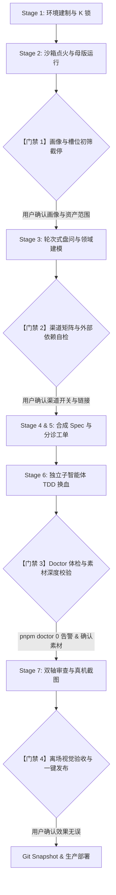

# XH-Blog-Workflow (芯火全栈网站热插拔生产工作流 · 终极加固版)

## Overview

`xh-blog-workflow` 将「芯火」经过实战检验的高级个人品牌站（基于 `cali.so` 6,972 行 CSS、半色调网点、WebGPU 着色器底盘与物理弹簧微交互）封装为一套**零走样、按序推进、三层责任隔离、四重截停确认的标准化生产工作流**。

它彻底解决了以往复刻过程中经常出现的「暗桩硬编码」、「删减文章或唱片测试崩溃」、「无公众号/推特出现 `#` 死链」、「AI 擅自手写简化组件丢失原版质感」等顽疾。任何人（无论是技术极客、历史学者、还是跨赛道创作者）都能通过本工作流在 10 分钟内完成 100% 真实资产换血，同时保持母版像素级视觉水准。

---

## 核心架构：三层职责划分 (Three Responsibility Tiers)

本工作流采用严格的不可变基础设施思想，将整个仓库分为清晰的三层：

```
┌─────────────────────────────────────────────────────────────┐
│ 1. K-Code Kernel (49 个固定内核文件 · SHA-256 物理加锁)     │
│    app/globals.css (6,972 行), WebGPU 着色器, 弹簧动效,     │
│    半调网点图像着色器, 基础布局骨架, 路由框架               │
├─────────────────────────────────────────────────────────────┤
│ 2. V-Slots (14 个动态槽位 · 纯数据与静态素材热插拔)         │
│    personal.ts, projects.ts, photos.ts, content/blog/,      │
│    public/images/* (头像/照片/二维码/封面/黑胶)             │
├─────────────────────────────────────────────────────────────┤
│ 3. A-Code Automation & Gates (全自动化保障与硬门禁)         │
│    pnpm doctor, verify-kernel, test:smoke, vitest (74 项),  │
│    verify:public-discovery, slot-config-panel.html          │
└─────────────────────────────────────────────────────────────┘
```

1. **K-Code Kernel（固定内核 · 49 个文件）**：
   - 受 `.kernel-lock.json`（LF 换行符归一化 SHA-256 哈希）物理锁死。
   - 严禁任何 AI 重新手写或简化组件；一旦哈希不匹配，CI 与门禁立即红灯阻断。
2. **V-Slots（动态槽位 · 14 项配置）**：
   - 包含品牌基础信息、弹性渠道矩阵、个人简介、真实履历、原创文章、实战项目、精选相册、3D 战绩书架与黑胶唱片。
   - 所有槽位支持自由增减、按需开启/关闭，无任何硬编码残留。
3. **A-Code Automation & Gates（自动化防线与硬门禁）**：
   - 涵盖从环境初始化、交互式盘问、预检体检（Doctor）、TDD 单元测试到全量 SSG 编译与公共发现协议（RSS/Sitemap/llms.txt）校验的完整工具链。

---

## 四大截停确认门禁 (Human-in-the-Loop Interception Gates)

为了防止 AI 闭门造车或擅自替用户做决策，工作流在四个关键阶段设立了**必须向用户主动截停、确认后才可继续**的硬门禁：



### 门禁 1：创作者画像与槽位范围初筛 (Persona & Slot Scoping)
- **触发时机**：Stage 2 沙箱点火成功，用户在 `http://localhost:3000` 看到母版初始运行后。
- **截停动作**：
  1. 向用户展示《14 个 V 槽位清单》与《3 种典型画像参考》（芯火/富兰克林/陈拾光）。
  2. 询问用户属于哪一类赛道，以及是否有特殊缺失项（如：无国内公众号、无博客文章、无代表作等）。
- **通过条件**：用户明确确认自己的画像定位与本次换血的槽位范围。

### 门禁 2：渠道矩阵与外部依赖自检 (Channel Matrix & Dead Links)
- **触发时机**：Stage 3 收集完社交渠道信息后，生成 `spec.md` 之前。
- **截停动作**：
  1. 梳理用户填写的渠道列表，检查是否有暂未开通或无需展示的渠道。
  2. 严正声明：**不展示的渠道直接剔除，严禁用 `#` 死链或虚假账号填补**。
  3. 若用户有专属微信公众号二维码，确认图片文件命名（如 `wechat-qr.jpg`）与弹窗文案；若无公众号，底栏 Dock 弹窗按钮自动无感隐藏。
- **通过条件**：用户确认渠道启用清单（`channels`）与禁用清单（`disabledChannels`）。

### 门禁 3：Doctor 全站体检与资产深度校验 (Pre-flight Doctor & Integrity)
- **触发时机**：Stage 6 子智能体完成数据与素材替换之后，进入最终构建与评审之前。
- **截停动作**：
  1. 运行 `pnpm run doctor`，自动检查：
     - 必填品牌槽位（中文名、英文名、Bio、坐标、头像等）是否完备。
     - 是否残留模板违禁词（如已退役邮箱、非官方盗版库链接 `z-library`、母版残留 `cali.so`、退役私人账号等）。
     - Markdown 文章是否少于 2 篇、文章内二级标题是否 `>= 2`。
     - 图片资源是否在 `public/` 目录下真实存在且非 0 字节。
  2. 若有任何一项不通过，向用户报备红灯项并自动修复，修复完成后才可放行。
- **通过条件**：`pnpm run doctor` 退出码为 `0`。

### 门禁 4：离场视觉验收与一键发布 (Exit Acceptance & Release)
- **触发时机**：Stage 7 真机截图（首页亮/暗色、文章页、项目页、相册页、Dock 栏）生成后。
- **截停动作**：
  1. 向用户输出生成的真机截图路径与对比报告。
  2. 请用户在真实浏览器中打开 `http://localhost:3000` 检查：
     - 首屏肖像网点显影与点击弹窗是否流畅。
     - 底部 Dock 栏小图标是否为本人高清原色头像。
     - 社交卡片悬浮与点击是否符合预期。
- **通过条件**：用户回复「验收通过」后，执行 `snapshot` 打 Tag 并交付上线。

---

## 弹性全渠道矩阵 (Elastic Channel Matrix)

针对不同创作者的社交资产差异（如技术极客偏好 GitHub/RSS/Email；跨赛道作者偏好小红书/即刻/微信公众号；海外学者偏好 Google Scholar/Podcast/X），母版在 `lib/channels.ts` 中封装了通用渠道矩阵：

| 渠道 Key | 默认渲染类型 (`kind`) | 专属微交互 / 行为 |
| :--- | :--- | :--- |
| `wechat` | `qr-image` | 点击触发底栏网点质感悬浮弹窗展示二维码，不跳出当前页 |
| `github` | `github-heatmap` | 自动请求公共 API 渲染 26 周实时绿格热力图与年度 Contributions |
| `email` | `email` | 渲染为经典瑞士航空贴票信封卡片，点击唤起系统邮件客户端 |
| `xiaobaotong` | `external` | 悬浮高亮，支持配置为「筹备中」徽章状态 |
| `xiaohongshu` | `external` | 专属矢量红书图标，安全在新标签页打开 |
| `bilibili` / `youtube` | `external` | 视频流媒体专属矢量图标 |
| `rss` / `podcast` | `external` | 订阅流与声音播客专属矢量卡片 |
| `scholar` / `store` | `external` | 学术引用或独立创作者小店外部直达 |

> [!TIP]
> 任何渠道只要未配置 URL、设置了 `disabled: true`，或加入 `disabledChannels: ['wechat']`，组件将 100% 自动优雅剪裁，**绝对不会在页面上留下空白占位或 `#` 死链**。

---

## 三大真实落地场景对标 (Persona Case Studies)

| 维度 | 场景 1：母版·芯火 (Xinhuo) | 场景 2：先驱·富兰克林 (Benjamin Franklin) | 场景 3：工程师·陈拾光 (Shiguang Chen) |
| :--- | :--- | :--- | :--- |
| **赛道定位** | 07年大专生 · AI自学与个人成长 | 18世纪博学家 · 启蒙主义作家与印刷商 | 95后系统工程师 · 开源架构与极客生活 |
| **英文名 / 坐标** | `xinhuo` · 广东深圳 (114.05, 22.54) | `franklin` · 费城 (75.16, 39.95) | `shiguang` · 浙江杭州 (120.15, 30.28) |
| **首屏肖像风格** | 现代极简半调网点 + 原色圆形头像 | 经典历史蚀刻网点油画 + 印刷机 Favicon | 极客工位半调写真 + 终端字符 Favicon |
| **渠道矩阵配置** | 微信公众号(弹窗) + 邮箱 + 小红书 + 小报童(筹备中) | 印刷所工坊公告 + 羊皮纸邮件信箱 | GitHub(26周热力图) + 个人邮件 + RSS订阅流 (彻底禁用微信) |
| **代表作项目** | 网站设计工作流、个人自学沉淀知识库 | 避雷针、双焦点眼镜、富兰克林炉设计图纸 | 高性能网关、分布式锁库、Markdown 增强插件 |
| **战绩书架与黑胶** | 《纳瓦尔宝典》、《穷查理宝典》等实用成长书 | 《自然哲学的数学原理》、《商业论》等古典名著 | 《Designing Data-Intensive Applications》、《深入理解计算机系统》 |
| **原创文章篇数** | 8 篇深度个人成长与 AI 实践长文 | 4 篇穷理查年鉴节选与科学论文 | 5 篇底层架构实战与代码重构笔记 |

---

## 极速操作指南 (Step-by-Step Execution)

### 1. 启动与预检体检
```bash
# 运行体检脚本（在任何阶段均可执行，秒级发现缺项与模板残留）
pnpm run doctor
```

### 2. 本地零代码可视化配置面板
如果你希望通过图形界面直接修改槽位配置，可在浏览器中双击打开：
`docs/slot-config-panel.html`
- 实时编辑 14 个动态槽位。
- 一键导入/导出 `.slots.json`。
- 一键复制格式化配置代码直接粘贴至 `lib/personal.ts`。

### 3. 全套严苛自动化门禁验证
```bash
# 1. 验证 49 个 K 代码文件哈希未被篡改
python tests/test_smoke.py

# 2. 运行 74 项单元与集成测试（涵盖弹性渠道、书架、项目、文章等）
pnpm test

# 3. TypeScript 静态类型完整性检查
pnpm exec tsc --noEmit

# 4. 全站 SSG 静态生成与构建（生成 21 个静态路由）
pnpm build

# 5. 公开发现协议全量自检（验证 /sitemap.xml, /feed.xml, /llms.txt）
pnpm verify:public-discovery
```

---

## 根因反思与防复发铁律 (Root Cause Analysis & Guardrails)

在多轮迭代中出现「换人测试挂掉」、「部分文案依然写死」的核心原因总结如下：

1. **根因一：假解耦（测试用例硬编码业务数据）**
   - *教训*：测试中直接 `expect(publishedPostSlugs.length).toBe(8)` 或断言 `records.length === 6`，导致换人后删减文章或黑胶时测试必崩。
   - *铁律*：**所有测试只验证契约不变性（如 `posts.length >= 1`，每个项目必须具备 `title/href/desc`），绝不允许对内容绝对数量做硬编码断言。**
2. **根因二：静态假设（误以为所有创作者都用同一种社交工具）**
   - *教训*：海外用户或纯技术人员根本没有微信公众号或小红书，原本硬编码的弹窗逻辑导致页面必须挂一个假的二维码或者 `#` 死链。
   - *铁律*：**必须通过 `lib/channels.ts` 的弹性渠道矩阵管理所有外部链接，任何缺失项一律无感自动隐藏，绝不向 UI 输出 `#` 死链。**
3. **根因三：缺乏前置把关人（Pre-flight Gatekeeper）**
   - *教训*：以前只有在最后的 `pnpm build` 或手工点进页面时才发现图片 404 或留有母版遗留文案。
   - *铁律*：**引入 `pnpm run doctor` 门禁，在代码进入构建前做 100% 静态扫描，阻断一切违规违禁项。**

---

## 盲测与自主执行参考清单 (Autonomous Blind Testing Reference)

当面对一个全新的被测人物且**没有任何外部提示或人类指导**时，严格按以下文档执行：

1. **真实图鉴与案例参考**：[`docs/SHOWCASE.md`](docs/SHOWCASE.md)（含富兰克林、芯火、乔布斯、陈拾光实测截图与多形态渠道矩阵呈现）
2. **0 提示词盲测标准规约**：[`docs/AUTONOMOUS_EXECUTION_GUIDE.md`](docs/AUTONOMOUS_EXECUTION_GUIDE.md)（含 6 步确定性流水线与 Doctor 自愈排障字典）
3. **多人物预置配置字典**：[`.slots.example.json`](.slots.example.json)（含四大典型赛道 Schema 范本）
4. **纯静态本地可视配置面板**：[`docs/slot-config-panel.html`](docs/slot-config-panel.html)

