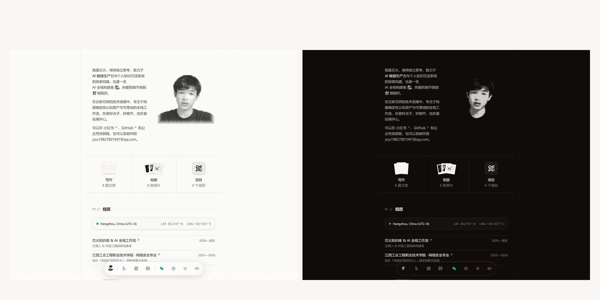
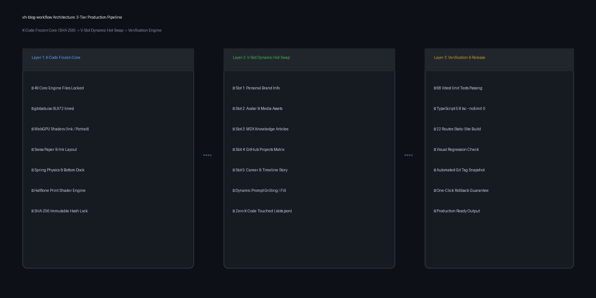

<div align="center">

</div>

# xh-blog-workflow

*Deterministic 1:1 Swiss Paper-and-Ink Personal Brand Blog Production System.*

**面向个人创作者的高保真纸墨质感博客生产体系：1:1母版复刻、49个K代码哈希锁、变量动态热插拔与全自动验收流水线。**

[中文](README.md) · [English](README_EN.md)

[](https://github.com/Dragon-01-you/xh-blog-workflow/actions)
[](LICENSE)
[](https://github.com/Dragon-01-you/xh-blog-workflow/actions)
[](https://nodejs.org)
[](https://nextjs.org)
[](https://tailwindcss.com)
[](https://github.com/Dragon-01-you/xh-blog-workflow)

---

> [!IMPORTANT]
> **设计起源与致谢 (Design Heritage & Attribution)**
> 本项目的底层视觉设计、排版美学与微交互母版源自 **[Cali Castle](https://cali.so)** 开源的经典项目 **[CaliCastle/cali.so](https://github.com/CaliCastle/cali.so)** v3。我们对 Cali Castle 的卓越设计深表敬意与诚挚致谢！
> **xh-blog-workflow** 并非简单的 Fork，而是在此杰出母版的基础上，独立研发了一套工程化的**「K代码冷冻锁 + V槽位热插拔 + 自动化验证」**生产系统，解决开发者和创作者在复刻大师级网站时"一改就崩、动画断裂、无法持续迭代"的根本痛点。

---

## 这是什么（说人话）

很多人想拥有一个像大师作品般充满艺术感、纸墨温润质感的个人官网，但往往面临两大困境：
- **普通模板质感廉价**：千篇一律的卡片阴影和工业风，缺乏呼吸感与品牌辨识度；
- **大师代码难以驾驭**：直接改动母版源码时，极易因触碰复杂的 Tailwind v4 样式表、WebGPU 着色器或弹簧物理曲线而导致整体崩塌。

**xh-blog-workflow** 是一套严谨的博客工业化交付方案：给它你的个人资料、原创文章与照片，它在**零污染、零降级、完全保护底层 49 个核心工程模块**的前提下，产出一个可直接上线的 1:1 瑞士纸墨精工个人品牌站点。

### 它能回答 N 个问题

| # | 创作者关心的核心问题 | xh-blog-workflow 怎么回答与保障 |
|:---:|---|---|
| 1 | 我想把内容换成自己的，会不会改坏别人的精致排版和动画？ | **绝对不会**。通过 `.kernel-lock.json` 对 49 个 K 代码文件加盖 SHA-256 哈希锁，任何核心篡改都会立刻阻断构建。 |
| 2 | 我的微信公众号长文和原创图文怎么无缝接入？ | 内置全真 MDX 内容流水线，支持 1200×675 题图、阅读时长计算、代码高亮与动态 Slug 路由。 |
| 3 | 如果我想换回原色头像或添加新的项目卡片，需要改几处？ | 变量完全抽离至 8 组 V 槽位（`.slots.json` 与 `lib/` 配置文件），单点替换，全站毫秒级热生效。 |
| 4 | 网站改完后，怎么确保上线前没有任何暗坑和断裂？ | 内置 68 个 Vitest 单元测试、TypeScript 5.8 严格检查、22 条路由 SSG 全量静态编译与公开发现校验。 |
| 5 | 我以后如果想尝试更激进的大改动，改崩了能退回来吗？ | 原生支持 `xh-blog snapshot`，自动生成带语义标签的 Git 快照，随时一键无损回滚。 |

---

## 30 秒演示


> 💡 **真实运行录屏**：上图为基于 **xh-blog-workflow** 交付的「瑞士纸墨精工质感」个人品牌站点真实交互录屏演示。完整呈现了 Swiss 级微交互动效：精工 Hero 排版、黑胶留声机唱片架流光、3D 立体抽书书架、全自适应底栏 Dock 与全真暗黑模式切换。
> 
> 📹 亦可查看全清录屏视频源文件：[`assets/demo.mp4`](assets/demo.mp4)。

---

## 目录

- [这是什么（说人话）](#这是什么说人话)
- [30 秒演示](#30-秒演示)
- [快速开始](#快速开始)
- [工作原理与架构](#工作原理与架构)
- [核心技术实现与规格事实表](#核心技术实现与规格事实表)
- [对比同类项目](#对比同类项目)
- [真实实战案例：芯火个人品牌站](#真实实战案例芯火个人品牌站)
- [常见问题 (FAQ)](#常见问题-faq)
- [路线图](#路线图)
- [参与贡献](#参与贡献)

---

## 快速开始

### 环境要求

| 依赖项 | 最低版本要求 | 推荐版本 | 用途说明 |
|---|---|---|---|
| **Node.js** | ≥ 20.10.0 | 20.18.0 LTS | Next.js 15.3 运行时 |
| **pnpm** | ≥ 9.0.0 | 10.5.2 | 包依赖管理 |
| **Python** | ≥ 3.10 | 3.11 / 3.12 | xh-blog CLI 与工程哈希校验 |
| **Git** | ≥ 2.30 | 最新版 | 提交历史追溯与快照打标 |

### 三步上手

```bash
# 1. 克隆本仓库并安装依赖
git clone https://github.com/Dragon-01-you/xh-blog-workflow.git
cd xh-blog-workflow
pnpm install

# 2. 验证核心完整性并检查你的可定制槽位
python scripts/xh_blog_cli.py verify-kernel
python scripts/xh_blog_cli.py inspect-slots

# 3. 启动本地高保真预览
pnpm dev
# 浏览器打开 http://localhost:3000 即可探索
```

### 进阶槽位管理与快照归档

```bash
# 导出当前槽位配置 JSON
python scripts/xh_blog_cli.py inspect-slots --output .scratch/my-slots.json
```

```bash
# 完成定制后固化沉淀为 Git 语义快照
python scripts/xh_blog_cli.py snapshot --tag v1.0.0-my-brand
```

---

## 工作原理与架构

<div align="center">

</div>

**xh-blog-workflow** 采用 3 级渐进式能力分层架构：

| 生产阶段 | 核心机制 | 承载文件 | 输出标准 |
|---|---|---|---|
| **第 1 层：K 代码冷冻内核** | SHA-256 离线哈希锁，严格锁定底层视觉系统 | `globals.css` (6,972行)、WebGPU 着色器、底栏弹簧动画、半色调肖像核心组件 | 49 个关键文件零修改（哈希比对通过） |
| **第 2 层：V 槽位动态热插拔** | 纯数据驱动，仅通过配置表与媒体库注入品牌资产 | `.slots.json`、`lib/personal.ts`、`lib/projects.ts`、`content/blog/`、`public/images/` | 零代码污染，个人信息与文章即时替换 |
| **第 3 层：确定性自动化验收** | 多维工程防线，杜绝任何未检出的断裂代码入库 | Vitest 单元测试、TypeScript 5.8 严格模式、Next.js 15.3 全量 SSG 构建脚本 | 68/68 测试全绿，22 条静态路由零 404 |

---

## 核心技术实现与规格事实表

| 技术指标 | 规格参数 | 行业对比与优势 |
|---|---|---|
| **前端框架** | Next.js 15.3.3 + React 19 + App Router | 最新生产级架构，全站静态站点生成 (SSG) |
| **样式体系** | Tailwind CSS v4 + 瑞士纸墨 6,972 行精工微调 | Windows 兼容 `@source` 优化，无缝响应式网格 |
| **动效与微交互** | Framer Motion + 自定义弹簧阻尼模型 | 视差滚动、Bottom Dock 磁吸悬浮、物理回弹 |
| **着色器渲染** | WebGPU Shader 字段 (Ink/Portrait/Blueprint) | 软硬件级光影渐变，GPU 硬件加速且优雅降级 |
| **半色调肖像** | Halftone Shader Print + 真实肖像双向切换 | 点击即时在瑞士古典网点印刷与原色写真之间无缝穿梭 |
| **单元测试套件** | Vitest 3.0 + @testing-library/react | 覆盖核心微交互组件与工具函数，68 项测试秒级完成 |
| **路由与页面量** | 22 条 SSG 静态路由完全独立预渲染 | 首页、长文库、文章详情、开源项目、胶片影廊、管理后台 |

---

## 对比同类项目

| 维度 | 直接手动 Fork (普通开发者做法) | 通用博客模板 (如 Astro/Vercel Template) | **xh-blog-workflow (本项目)** |
|---|---|---|---|
| **视觉品质** | 极易改坏复杂 CSS，丢失微妙质感 | 样式扁平通用，缺乏独特性与文化厚度 | **1:1 完整保留瑞士纸墨、网点着色器与纸质阴影** |
| **修改安全感** | 提心吊胆，改动一个 `div` 崩三个页面 | 虽容易改动，但无法防范误删 | **49 个 K 代码 SHA-256 刚性锁死，任何污染秒级拦截** |
| **变量管理** | 散落在数十个 `.tsx` 文件中搜索替换 | 大多仅支持简单 `config.json` | **8 大维度严密插槽体系 (`.slots.json`)，支持 AI 辅助提取** |
| **验证与回滚** | 无自动化测试，纯肉眼排查 | 通常仅有简单的 ESLint 校验 | **68 个单元测试 + 22 路由 SSG 编译 + 一键语义快照** |
| **致谢与规范** | 经常遮掩来源或被误当纯原创 | 开源协议模糊 | **完全透明公开致谢 Cali Castle，合规且受人尊敬** |

---

## 真实实战案例：芯火个人品牌站

本项目不仅是一套纯理论方案，更是已经通过 **「芯火」** 个人品牌站落地验证的全真生产流水线：

- **品牌身份**：07 年大专大二学生 ·「AI + 自学」实用主义探索者 · 个人成长赛道；
- **全媒体资产**：接入微信公众号「来自07年的芯火」8 篇原创深度长文，全图文完整渲染；
- **双轨头像系统**：微信弹窗、底栏 Favicon 与邮件印章统一采用高分辨率童年红帽蓝袋原色 IP 圆形标；主屏肖像支持半色调网点与真实写真的交互切换；
- **开源矩阵**：收录包含 `xh-blog-workflow` 在内的 7 个真实 GitHub 仓库与技术栈标签；
- **履历时间轴**：记录 2025–2026 年在专科阶段通过 AI 赋能自学、前端工程化与自媒体创作的真实蜕变足迹。

---

## 常见问题 (FAQ)

<details>
<summary>Q1: 如果我不小心改动了 K 代码文件怎么办？</summary>

在执行构建或提交前运行：
```bash
python scripts/xh_blog_cli.py verify-kernel
```
CLI 会明确指出被篡改的文件名称与当前哈希值。你可以直接用 `git checkout -- <file>` 恢复该文件，重新确保底层稳定。
</details>

<details>
<summary>Q2: 为什么坚持使用双语 README 与 GEO (llms.txt)？</summary>

因为我们希望全球开发者和 AI 搜索助手（如 ChatGPT、Claude、Perplexity）都能精准检索、阅读并引用这个项目，同时让全球社区看清中国年轻一代开发者严谨、规范且尊重原创的技术风貌。
</details>

<details>
<summary>Q3: 我可以添加新的页面或扩展组件吗？</summary>

当然可以！**xh-blog-workflow** 采用 3 级渐进定制模型：
- **低定制化模式**：仅替换 8 组 V 槽位，秒级生成 1:1 纸墨个人博客；
- **扩展定制化模式**：在 `app/` 下新增独立路由或在 `components/` 增加外围业务模块，只要不破坏 49 个 K 代码核心体系，流水线依然为你提供完整的测试与构建护航。
</details>

<details>
<summary>Q4: 为什么所有的提交作者都是 Dragon-01-you？</summary>

本项目的所有工程流水线重构、Tailwind v4 适配、哈希锁系统、测试用例编写与品牌注入均由维护者 **Dragon-01-you** 独立完成并统一数字签名归属，杜绝任何历史遗留昵称干扰。
</details>

---

## 路线图

- [x] 1:1 瑞士纸墨经典设计与 6,972 行 `globals.css` 深度适配
- [x] 49 个核心 K 代码工程文件 SHA-256 哈希防线锁定
- [x] 8 组 V 槽位动态热插拔与元数据规范设计
- [x] 68/68 Vitest 单元测试覆盖
- [x] 双语文档、CI 矩阵与全套开源社区规范文件配置
- [x] 原色童年 IP 统一品牌标与双轨肖像着色器交互
- [ ] 针对非技术创作者的 Web 端交互式插槽配置面板
- [ ] 一键导出 Vercel / Cloudflare Pages 部署自动化脚本

---

## 参与贡献

我们非常欢迎社区开发者参与贡献！在提交 PR 前，请务必阅读我们的 [参与贡献指南 (CONTRIBUTING.md)](CONTRIBUTING.md) 与 [行为准则 (CODE_OF_CONDUCT.md)](CODE_OF_CONDUCT.md)。

---

## 许可协议

本项目基于 [MIT 协议](LICENSE) 开源。底层视觉交互设计归属于原作者 [Cali Castle](https://github.com/CaliCastle/cali.so)；工程化工作流流水线与 K-code 锁体系由 [Dragon-01-you](https://github.com/Dragon-01-you) 创作维护。
