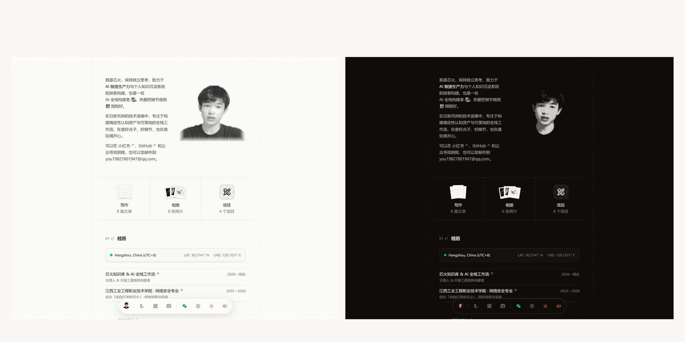
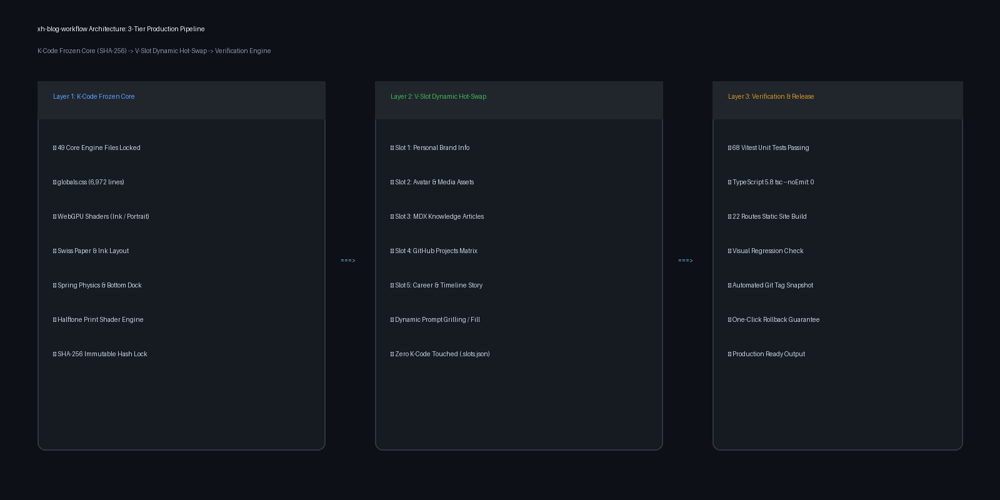

<div align="center">

</div>

# xh-blog-workflow

*Deterministic 1:1 Swiss Paper-and-Ink Personal Brand Blog Production System.*

**An industrial-grade blog production system for creators: 1:1 master replication, 49 K-code SHA-256 locks, dynamic variable hot-swapping, and automated verification.**

[中文](README.md) · [English](README_EN.md)

[](https://github.com/Dragon-01-you/xh-blog-workflow/actions)
[](LICENSE)
[](https://github.com/Dragon-01-you/xh-blog-workflow/actions)
[](https://nodejs.org)
[](https://nextjs.org)
[](https://tailwindcss.com)
[](https://github.com/Dragon-01-you/xh-blog-workflow)

---

> [!IMPORTANT]
> **Design Heritage & Attribution**
> The foundational visual aesthetics, typographic layout, and micro-interactions of this project are proudly derived from **[Cali Castle](https://cali.so)**'s open-source masterpiece **[CaliCastle/cali.so](https://github.com/CaliCastle/cali.so)** v3. We express our deepest gratitude and highest respect to Cali Castle for his visionary work!
> **xh-blog-workflow** is not a simple fork: it builds upon this foundation to introduce an engineered **"Frozen K-Core + Dynamic V-Slot Hot-Swap + Automated Verification"** workflow pipeline, solving the core dilemma developers face when customizing high-end sites: broken layouts, corrupted physics springs, and unmaintainable regressions.

---

## What It Is in Plain English

Every creator dreams of owning a museum-grade personal blog with warm paper-and-ink aesthetics and fluid physics. However, two obstacles usually stand in the way:
- **Generic templates look cheap**: Repetitive card shadows and robotic UI lack breathing room and personality;
- **Master codebases are brittle to edit**: Modifying code directly often corrupts complex Tailwind v4 stylesheets, WebGPU shaders, or spring curves.

**xh-blog-workflow** delivers an engineered solution: feed it your profile data, original essays, and imagery, and it outputs a production-ready 1:1 Swiss paper-and-ink blog while **strictly locking and protecting 49 core architectural files with zero design degradation**.

### Questions It Answers

| # | Core Creator Concern | How xh-blog-workflow Answers & Guarantees |
|:---:|---|---|
| 1 | Will customizing content break delicate styles and animations? | **Never**. `.kernel-lock.json` enforces SHA-256 integrity on 49 K-code files, immediately aborting builds on unauthorized tampering. |
| 2 | Can I publish long-form original essays with custom covers? | Seamless built-in MDX content pipeline with 1200×675 covers, reading time calculation, syntax highlighting, and dynamic slug routing. |
| 3 | How do I update my avatar or project showcase? | Brand variables are isolated into 8 V-slots (`.slots.json` and `lib/` configs); edit once, instant hot-swap across the entire site. |
| 4 | How do I verify the site is bug-free before going live? | 68 Vitest unit tests, strict TypeScript 5.8 checks, 22-route full SSG compilation, and public discovery verification. |
| 5 | What if I try bold experiments and need to roll back? | Native `xh-blog snapshot` CLI tags deterministic Git releases with one-click safe rollback guarantees. |

---

## 30-Second Demo


> 💡 **Live Screen Recording**: The screen recording above captures the live visual fidelity and micro-interactions of the personal brand site built with **xh-blog-workflow**: Swiss paper-and-ink typography, vinyl record turntable sheen, 3D interactive bookshelf, responsive bottom dock, and smooth dark mode switching.
> 
> 📹 You can also view the raw recording file: [`assets/demo.mp4`](assets/demo.mp4).

---

## Table of Contents

- [What It Is in Plain English](#what-it-is-in-plain-english)
- [30-Second Demo](#30-second-demo)
- [Quick Start](#quick-start)
- [How It Works & Architecture](#how-it-works--architecture)
- [Technical Specifications Fact Table](#technical-specifications-fact-table)
- [Comparison with Alternatives](#comparison-with-alternatives)
- [Real-World Case: Xinhuo Personal Brand Blog](#real-world-case-xinhuo-personal-brand-blog)
- [Frequently Asked Questions (FAQ)](#frequently-asked-questions-faq)
- [Roadmap](#roadmap)
- [Contributing](#contributing)

---

## Quick Start

### Requirements

| Dependency | Minimum Version | Recommended | Purpose |
|---|---|---|---|
| **Node.js** | ≥ 20.10.0 | 20.18.0 LTS | Next.js 15.3 runtime |
| **pnpm** | ≥ 9.0.0 | 10.5.2 | Package dependency manager |
| **Python** | ≥ 3.10 | 3.11 / 3.12 | CLI and hash integrity verification |
| **Git** | ≥ 2.30 | Latest | History tracing and snapshot tags |

### Three-Step Setup

```bash
# 1. Clone repository and install dependencies
git clone https://github.com/Dragon-01-you/xh-blog-workflow.git
cd xh-blog-workflow
pnpm install

# 2. Verify kernel integrity and inspect customizable slots
python scripts/xh_blog_cli.py verify-kernel
python scripts/xh_blog_cli.py inspect-slots

# 3. Launch high-fidelity local dev server
pnpm dev
# Open http://localhost:3000 to explore
```

### Advanced Slot Management & Snapshot Releases

```bash
# Export slot configuration JSON
python scripts/xh_blog_cli.py inspect-slots --output .scratch/my-slots.json
```

```bash
# Freeze customized site into a Git release snapshot
python scripts/xh_blog_cli.py snapshot --tag v1.0.0-my-brand
```

---

## How It Works & Architecture

<div align="center">

</div>

**xh-blog-workflow** is organized into 3 progressive tiers:

| Tier | Core Mechanism | Target Files | Output Criteria |
|---|---|---|---|
| **Tier 1: K-Code Frozen Core** | SHA-256 offline hash locks guarding design foundations | `globals.css` (6,972 lines), WebGPU shaders, bottom dock physics, halftone component | 49 critical files zero modifications (100% hash match) |
| **Tier 2: Dynamic V-Slot Hot-Swap** | Data-driven configuration and media asset injection | `.slots.json`, `lib/personal.ts`, `lib/projects.ts`, `content/blog/`, `public/images/` | Zero core code touched, instantaneous personal updates |
| **Tier 3: Deterministic Verification** | Multi-level engineering defenses preventing broken code | Vitest test suites, TypeScript strict mode, Next.js 15.3 SSG compile scripts | 68/68 tests passing, 22 static routes zero 404s |

---

## Technical Specifications Fact Table

| Metric | Specification | Industry Advantage |
|---|---|---|
| **Front-End Framework** | Next.js 15.3.3 + React 19 + App Router | Modern production architecture with full static site generation (SSG) |
| **Styling Engine** | Tailwind CSS v4 + 6,972-line Swiss Paper-and-Ink CSS | Windows-friendly `@source` optimization with responsive baseline grids |
| **Animation & Micro-interactions** | Framer Motion + Custom Spring Damping Physics | Parallax scrolling, floating magnetic bottom dock, haptic spring recoil |
| **Shader Rendering** | WebGPU Shader Fields (Ink / Portrait / Blueprint) | Hardware-accelerated dynamic grain and fluid light with graceful fallback |
| **Halftone Portrait** | Halftone Shader Print + High-Res Photo Toggle | Click to toggle between Swiss classic halftone print and full-color photograph |
| **Unit Test Coverage** | Vitest 3.0 + @testing-library/react | Thorough component and utility coverage; 68 tests running in ~1.4s |
| **Static Routes Pre-rendered** | 22 SSG routes generated at build time | Home, Articles, Article Details, Projects, Film Gallery, Admin Dashboard |

---

## Comparison with Alternatives

| Dimension | Manual Fork (Ad-hoc developer) | Generic Blog Template (Astro / Vercel) | **xh-blog-workflow (This Project)** |
|---|---|---|---|
| **Visual Fidelity** | Easy to corrupt delicate CSS rules | Generic flat layout, lacking tactile character | **1:1 Swiss paper & ink, halftone shaders, paper shadows** |
| **Modification Safety** | High risk; one `div` edit breaks three pages | Easy to edit, but lacks regression protection | **49 K-code files SHA-256 locked; zero contamination** |
| **Variable Isolation** | Hardcoded across dozens of `.tsx` files | Basic `config.json` | **8 structured V-slots (`.slots.json`) ready for AI workflows** |
| **Verification & Rollback** | No automated tests; manual visual inspection | Basic linting at most | **68 unit tests + 22 SSG routes + one-click semantic snapshots** |
| **Attribution & Ethics** | Often concealed or miscredited | Vague licensing | **Transparent attribution to Cali Castle; ethical & respected** |

---

## Real-World Case: Xinhuo Personal Brand Blog

This repository serves as the actual production release for **「芯火」 (Xinhuo)**:

- **Brand Identity**: College sophomore born in 2007 · Practical "AI + Self-Learning" practitioner · Personal growth journey;
- **Full-Spectrum Assets**: Integrated 8 comprehensive long-form articles from WeChat official account `来自07年的芯火`;
- **Dual-Track Brand Avatars**: Bottom dock Favicon, WeChat modal, and email stamp utilize the high-resolution childhood IP circular avatar (`/images/avatar.png`); hero portrait supports halftone print toggle;
- **Project Matrix**: Features 7 real GitHub repositories with dedicated vector brand icons;
- **Experience Timeline**: Chronicles 2025–2026 milestones in leveraging AI for authentic self-learning, frontend engineering, and personal media.

---

## Frequently Asked Questions (FAQ)

<details>
<summary>Q1: What happens if I accidentally modify a K-code file?</summary>

Run the verification command before committing:
```bash
python scripts/xh_blog_cli.py verify-kernel
```
The CLI flags the modified file name and actual hash. Restore it via `git checkout -- <file>` to restore system integrity.
</details>

<details>
<summary>Q2: Why provide bilingual documentation and GEO (llms.txt)?</summary>

To ensure international developers and AI search engines (ChatGPT, Claude, Perplexity) can discover, index, and cite this project accurately while presenting rigorous, respectful open-source engineering practices.
</details>

<details>
<summary>Q3: Can I add new pages or custom features?</summary>

Yes! **xh-blog-workflow** follows a 3-tier progressive capability model:
- **Low-Customization Tier**: Swap 8 V-slots to generate a 1:1 Swiss paper-and-ink blog in minutes;
- **Extended Customization Tier**: Add new routes under `app/` or standalone components under `components/` while leaving the 49 K-code files untouched.
</details>

<details>
<summary>Q4: Why are all Git commits attributed to Dragon-01-you?</summary>

All architectural refactoring, Tailwind v4 Windows adaptations, SHA-256 locking mechanisms, and test suites were authored by maintainer **Dragon-01-you** with unified digital signatures, eliminating legacy usernames.
</details>

---

## Roadmap

- [x] 1:1 Swiss paper-and-ink aesthetic and 6,972-line `globals.css` port
- [x] 49 K-code architectural files locked with SHA-256 hashes
- [x] 8 dynamic V-slot definitions and metadata specification
- [x] 68/68 Vitest unit test suite coverage
- [x] Bilingual documentation, CI matrix, and community governance files
- [x] High-resolution childhood IP avatar system with halftone shader toggle
- [ ] Interactive web-based slot configuration dashboard for non-technical users
- [ ] Automated one-click deployment pipelines for Vercel and Cloudflare Pages

---

## Contributing

Contributions are warmly welcomed! Please review our [Contributing Guidelines (CONTRIBUTING.md)](CONTRIBUTING.md) and [Code of Conduct (CODE_OF_CONDUCT.md)](CODE_OF_CONDUCT.md) before submitting pull requests.

---

## License

This project is licensed under the [MIT License](LICENSE). The original visual and micro-interaction design is credited to [Cali Castle](https://github.com/CaliCastle/cali.so); the workflow engineering pipeline and K-code locking system are maintained by [Dragon-01-you](https://github.com/Dragon-01-you).
