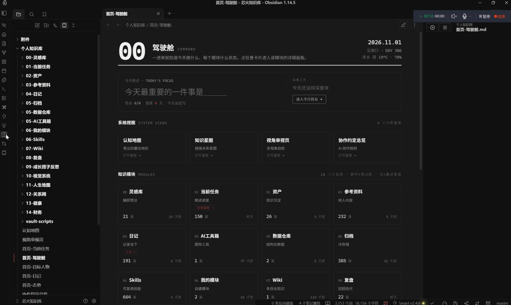

一直在想，一所高职院校的真实办学数字，到底该怎么被大众真正看见。

以前传统的招生宣讲与宣传材料，要么是一张干瘪的折线图，要么是一段念稿式的官方汇报：
在校生 12,500 人、初次就业率 96.3%、专任教师 586 名、专升本录取率 78.1%……
数字密密麻麻印在册子上，但家长和考生翻过去就忘了。为什么？因为这些数字冷冰冰的，**缺乏画面感**。

这三周我沉下心来做的，就是把这些沉睡在报表里的枯燥数字，变成一块能被自由“漫游浏览”的交互式数字活名片。

*母校数据活名片交互驾驶舱：将五大核心维度转化为可视化的叙事看板*

## 一、核心思路：把学校当成一个可以被“逛”的产品

我没有一上来就去罗列图表，而是先站在考生和家长的视角问自己：如果一个人想真正了解这所位于江西的高校，他的认知动线是怎样的？

顺着这个思路，我把整套系统重构为五个递进的叙事模块，就像带着一位新生实地漫游校园一样，自然连贯：

**学校概况 → 师资力量 → 教学成果 → 竞赛高光 → 设施资源**

每一个模块，专注回答一个最关切的问题：
- 这所学校有多大体量？
- 授课老师是什么水准？
- 毕业生发展与升学通道顺畅吗？
- 学生在全国技能大赛中拿过什么奖项？
- 宿舍与实训硬件条件到底怎么样？

## 二、五个模块的精准定位

### 1. 学校概况（底盘初印象）
打头阵的概况看板将 12,500 名在校生、占地面积与重点院系设置清晰陈列，让访客在 3 秒内对学校办学规模形成坚实直观的宏观概念。

### 2. 师资力量（从数字到面孔）
586 名教师不再只是一个数字。系统细分了高级职称与“双师型”骨干教师的占比，把“有多少好老师”转化为“好老师结构长什么样”。

### 3. 教学成果（升学托举力）
在这一板块，**78.1% 的专升本升学率** 被设为全屏视觉焦点。对于很多专科生家庭而言，相比宽泛的就业率，这个数字更直接证明了学校能否托举学子向更高平台跨越。

### 4. 竞赛成果（高光时刻见证实训）
按国家级、省级与行业赛分类陈列历年获奖。奖杯不是装饰，而是专业技能硬实力的实证。

### 5. 设施资源（学习生活沉浸感）
工业级实训基地、数字化图书馆与标准化公寓环境，配上真实指标参数，让未来的校园生活触手可及。

## 三、设计的底层原则：把数字翻译为“画面”

同组数字，写在 Word 文档里没人读，做成一块有对比、有主次、能交互钻取的看板，人们就会主动停下来探索。

在这次设计中，我恪守了三条铁律：
1. **一个屏幕只突出一个核心主焦点**，其余辅助数据合理降噪；
2. **严谨的色彩层级系统**：重要指标采用品牌强调色，次要参数退回低对比度背景；
3. **模块既能独立成篇，组合起来又是一条闭环叙事**。

在招生宣讲现场打开这套数据看板，其说服力远胜厚厚厚十页宣传册。

三周的熬夜打磨并不轻松，但看到那些原本埋在年报里的数字第一次变得生动可触、让人记得住，就觉得所有付出都无比值得。

**数字本身或许不发声，但把数字讲成动人的画面，它就能照亮人心。**
