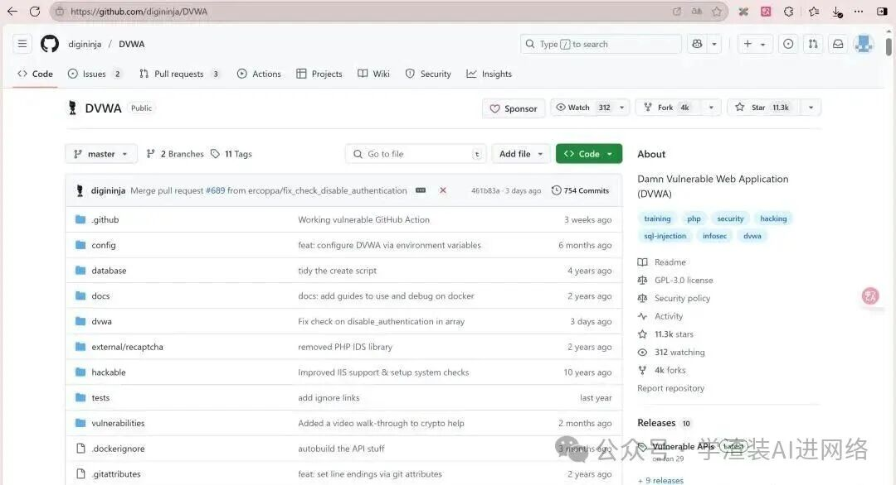
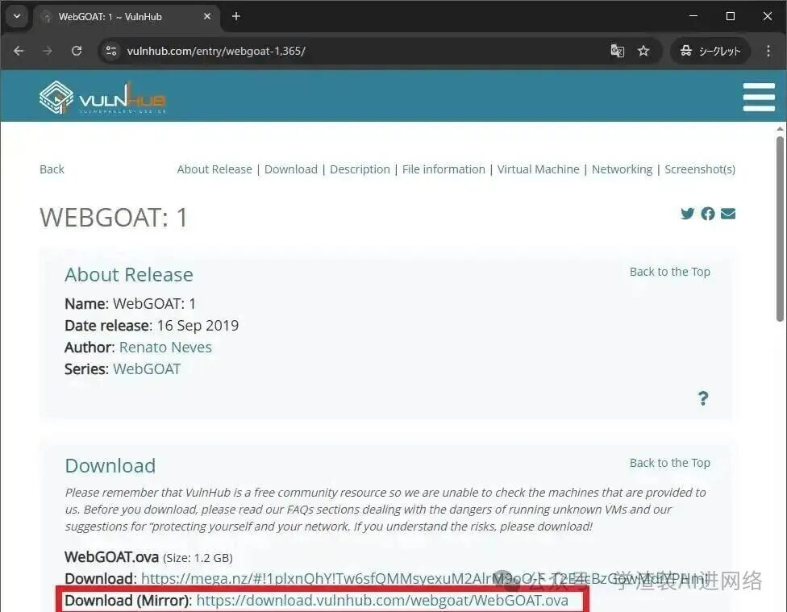
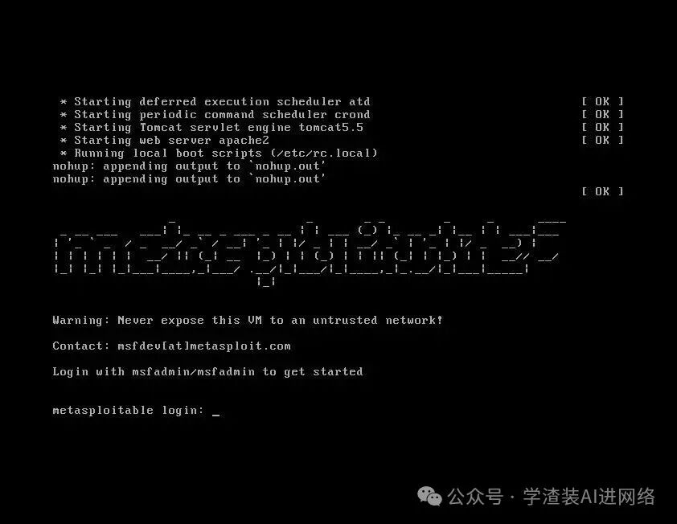
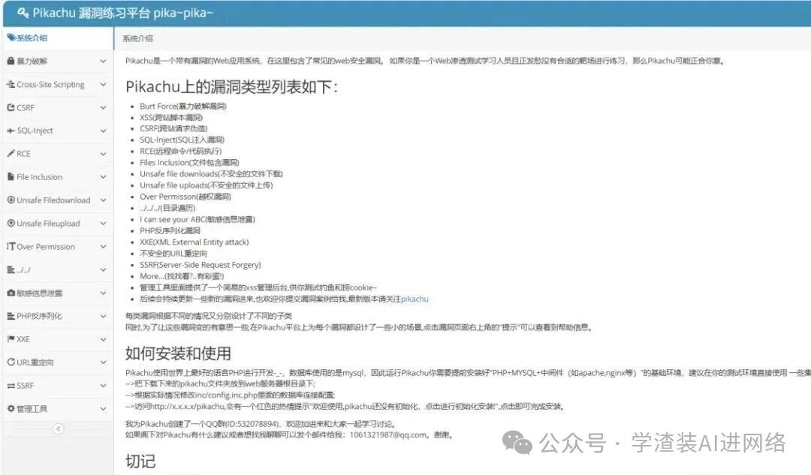
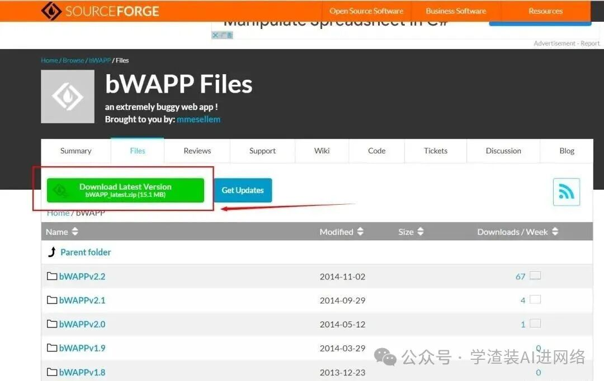

作为一名刚进入网络安全专业的大一新生，最常被学弟和同级朋友问到的问题就是：“我想练渗透测试和网络攻防，到底去哪里找目标？”

> **⚠️ 法律铁律（绝对红线）：技术无罪，但人必须守法！**
> 
> 所有测试与攻防演练，**绝对且只能在本地隔离虚拟机、或本人独立购买的专用测试服务器中进行！**
> 严禁扫描、探测或攻击任何未经官方明确书面授权的网络目标！别技术没学成，先喜提“银手镯”，那可就血亏到姥姥家了。

今天我把我亲手刷过多遍、100% 合法且适合小白入门打基础的 **5 大本地开源靶场** 一次性汇总给大家。

## 一、DVWA：网安人必刷的“Hello World”神级靶场



### 靶场介绍与特色
DVWA（Damn Vulnerable Web App）是全球公认的网安入门第一神级靶场。我刚入学时 Web 基础全靠它打牢，前后刷了不下 3 遍。

### 核心功能与等级
- 覆盖 SQL 注入、XSS 跨站脚本、任意文件上传、CSRF 跨站请求伪造等经典 Web 漏洞；
- 独创 **Low / Medium / High / Impossible** 四个安全防御级别，支持逐级对抗进阶；
- PHP + MySQL 架构，社区资料极度丰富。

### Docker 一键部署命令
```bash
docker run -d -p 80:80 vulnerables/web-dvwa
# 访问地址：http://localhost/login.php
# 默认凭据：admin / password
```
官方仓库：`https://github.com/digininja/DVWA`

## 二、OWASP WebGoat：官方亲妈级教学靶场



### 靶场介绍与特色
OWASP 官方团队专为教学打造的“带教老师”级靶场。和别的靶场直接扔给你一个黑盒不同，WebGoat **先讲原理、再给场景、最后引导你完成修复**。

### 核心亮点
- 详细的原理解释与学习路径，每道题自带知识卡片与参考答案；
- 覆盖最新的 API 接口安全、JWT 令牌缺陷、反序列化等现代化漏洞；
- Java 体系构建，适合深入理解企业级后端防护。

### Docker 运行命令
```bash
docker run -d -p 8080:8080 -p 9090:9090 webgoat/webgoat-8.0
# 访问地址：http://localhost:8080/WebGoat
```

## 三、Metasploitable2：内网渗透与系统提权神器



### 靶场介绍与特色
Metasploit 官方出品的“千疮百孔”Linux 虚拟机环境，专为练习内网渗透与系统级漏洞利用打造。

**⚠️ 重要注意：只能在 VMware/VirtualBox 的 Host-Only（仅主机）私有网络中运行，切勿桥接到公网！**

### 核心玩法
- 模拟真实内网主机，内置 Samba、vsftpd 弱口令及未修补漏洞；
- 绝佳的 Nmap 端口扫描与 Metasploit（MSF）自动化利用练习场；
- 默认凭证：`msfadmin / msfadmin`。

## 四、Pikachu（皮卡丘）：国内开发者打造的中文友好靶场



### 靶场介绍与特色
很多新生看英文界面吃力，Pikachu 靶场是国内安全研究员开发的纯中文靶场，对新手极其友好，再也不用一边实操一边切翻译软件。

### 核心功能
- 全中文交互，每个关卡附带中文漏洞原理说明与新手提示；
- 包含“新手入门区”，手把手讲解常见 Burp Suite 抓包操作；
- 完美支持 phpStudy 快速解压启动。

## 五、BWAPP：漏洞类型最全的“百科全书”



### 靶场介绍与特色
当你在 DVWA 和 Pikachu 通关后，想挑战更广泛的冷门漏洞场景，BWAPP（buggy Web Application）就是最好的进阶库，包含超过 100 种真实 Web 漏洞场景。

### Docker 运行命令
```bash
docker run -d -p 80:80 raesene/bwapp
# 访问：http://localhost/bWAPP/login.php
# 凭据：bee / bug
```

## 总结：稳永远比快重要

网络安全是一门重实践、重责任的学科。这 5 大本地靶场从基础 Web 注入到内网扫描全方位覆盖，足够我们在本地踏踏实实夯实基石。

**技术是用来守护网络空间清朗与资产安全的盾牌，绝非炫技犯险的工具。** 一起在合法合规的边界内精进成长！
