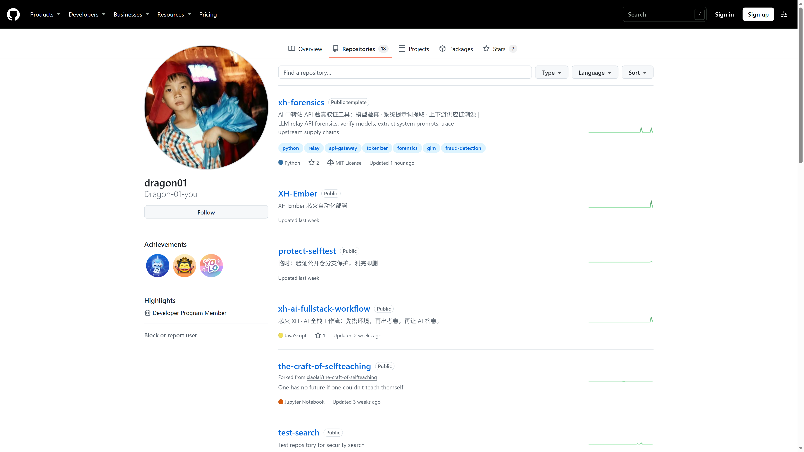

你是不是也在用 AI 开发一些东西？只要输入几句话，喝一杯水的功夫，“啪”的一下 AI 全给你写完了。但关掉窗口后，总觉得心里空落落的：我的技术到底有没有提升？我还能从这种开发方式里真正学到东西吗？

我也为此苦恼了很久。直到我深入观察了国内外一线顶尖开发者的真实工作流，才发现他们与普通玩家的开发方式不仅不是一模一样，简直是差了十万八千里。

> **核心发现：我们是在疲于答卷；而那些顶尖的开发者，自始至终都在给 AI 出题。**

你把时间都花在“被动回答 AI 的提问”上，还是花在“给 AI 出考卷、设门禁并严格验证”上，这就是差距的根本源头。

顶尖全栈工作流大概包含六个关键环扣：
**环境搭建 → 需求澄清 → 最小测试 → 开发实现 → 验收上线 → 部署迭代**

如果把这套流程翻译成考试的语言，你会发现每一步都对应得严丝合缝：

## 一、环境搭建：给 AI 立好规矩与安全红线

大家最容易忽略的一步就是搭建环境。很多人以为环境搭建就是敲个 `git init`，其实远不止于此。

一个抗风险的 AI 协作环境必须包含：
1. **项目规范与地图 (`AGENTS.md`)**：清晰告知 AI 项目的架构 seam、依赖版本、目录边界与严禁触碰的红线；
2. **自动化提交门禁 (`pre-commit`)**：在代码提交前执行类型检查、格式化与单元测试，拦截任何劣质代码；
3. **版本快照回退能力**：确保每一步都有确定性 checkpoint。

给 AI 写规范绝非故弄玄虚——在开源世界里，`AGENTS.md` 规范已被数以万计的项目采纳。有了严密的环境边界，AI 才不会在上千行代码中出现上下文丢失、胡乱魔改或脱节崩塌。

## 二、需求澄清：不写代码前的“灵魂三问”

在让 AI 敲下第一行代码之前，先问自己三个问题：

1. **我们要的是最终成品，还是要掌握这项技能本身？**（如果是为了学习，就绝对不能让 AI 一把梭全部写完，而要让它引导与陪练）；
2. **交付的成功标准到底是什么？**（具体的验收指标，而非抽象的“好看、好用”）；
3. **时间与性能的边界条件是什么？**

最后必须产出明确的 `proposal.md`（设计提案文档）和 `task.md`（原子任务清单）。先对齐考纲，再开始答题。

## 三、测试先行 (TDD)：输出倒逼输入的终极哲学

第三点我认为是最核心的灵魂：**测试驱动开发（TDD）**。

传统的做法是写完代码再测，甚至压根不测。而 TDD 是完全反过来的：**开发前先出考卷**。

其经典循环是著名的“红-绿-重构”：
1. **故意报错（Red）**：先写一个单元测试，明确定义输入什么、期望输出什么。此时尚未实现功能，测试必然失败亮红；
2. **修复变绿（Green）**：让 AI 仅编写满足该测试的最小代码，直到测试变绿通过；
3. **重构优化（Refactor）**：在绿色安全网的保护下，让 AI 优化代码结构、消除冗余。

以用户注册为例：你先不写注册逻辑，而是先写一个测试用例——输入长度小于 3 的用户名必须抛出校验错误。跑一下必定报错；接着让 AI 写校验代码让测试通过；最后再让 AI 提高代码健壮性。

**TDD 的本质是用输出倒逼输入。**

在写这篇文章时，我也并非对所有技术细节了如指掌；但在出卷、设问、跑测试的过程中，不清楚的点全部暴露出来，倒逼我针对性地查证搞懂。这种用输出倒逼输入的哲学，不仅适用于软件工程，也是现实生活中最高效的终身学习方法。

## 四、开源固化：xh-ai-fullstack-workflow

我把这一整套工作流固化为了一个可被任何 AI 工具读取并重复执行的 skill 开源项目：

👉 **GitHub 仓库**：[Dragon-01-you/xh-ai-fullstack-workflow](https://github.com/Dragon-01-you/xh-ai-fullstack-workflow)

*仓库首页实拍：先搭环境，再出考卷，再让 AI 答卷*

我们和顶尖开发者的差距，不在于手里掌握了多少高级提示词，而在于你到底是在被动“答卷”，还是在主动“出题”。把环境搭牢、把需求理透、把测试写在前面，你才能从人机协同中获得真正带得走的本领。
