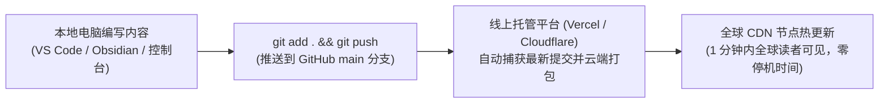

# 博客日常维护、内容发布与线上自动同步指南
# Daily Maintenance, Content Publishing & Online Sync Guide

> **面向站长**：当你的个人品牌网站首次搭建完成并上线后，后续该如何**发新文章**、**改个人信息**、**增删书架/项目**，以及**如何一键同步部署到线上公网**？本指南提供最接地气、无门槛的傻瓜式实战教程。

---

## 一、 控制面板（`/admin`）是干嘛的？可以进去编辑吗？

许多站长第一次进入控制面板时，会好奇：*“这到底是个纯监控表盘，还是真能改东西的后台？”*

在最新版本中，后台 [`/admin`](http://localhost:3000/admin) 已全面升级为**三位一体的工作台**：

```
┌─────────────────────────────────────────────────────────────────┐
│ 01 // 运维巡检大盘：看全站字数、8篇长文、网关健康度、RSS/Sitemap │
├─────────────────────────────────────────────────────────────────┤
│ 02 // 槽位极速编辑：直接在网页上改名字、Bio、城市，一键复制配置代码 │
├─────────────────────────────────────────────────────────────────┤
│ 03 // 日常同步指引：一文读懂发新文章、改照片、GitOps 自动上线流水线 │
└─────────────────────────────────────────────────────────────────┘
```

### 1. 能不能编辑？怎么编辑？
- **可以！** 进入 `/admin` 并输入口令解锁后，点击顶部 **「02 // 槽位极速编辑 (Quick Edit)」** 选项卡。
- 你可以直接在网页输入框里修改你的**中文名、英文名、一句话身份标签 (Tagline)、个人自述 (Bio)、所在城市以及联系邮箱**。
- 修改后，你可以：
  - 点击 **「📋 一键复制 TypeScript 配置代码」**：直接覆盖项目根目录的 `lib/personal.ts`；
  - 点击 **「💾 下载 .slots.json 备份」**：导出最新的配置数据。
- 若需要进行深度配置（如增删 3D 书架、黑胶唱片、真实履历时间轴、精选相册），可直接双击打开本地离线工作台：[`docs/slot-config-panel.html`](slot-config-panel.html)。

---

## 二、 后期我想更新，具体该怎么办？

### 场景 1：我想写一篇新的原创长文，怎么发布？（只需 4 步）

1. **新建文章文件夹**：  
   进入 `content/blog/`，新建一个以英文为命名的文件夹（例如：`content/blog/my-new-ai-journey/`）。
2. **放置正文与封面图**：  
   - 在该文件夹内新建 `index.mdx`，在顶部写上基础信息：
     ```markdown
     ---
     title: "从零开始用 AI 做出属于自己的个人品牌站"
     description: "记录我作为一个大二学生，如何通过工作流交付网站的真实心得。"
     publishedAt: "2026-11-05"
     image: "/content/blog/my-new-ai-journey/cover.jpg"
     ---

     ## 一、 为什么我要做这件事？
     这里写正文第一段...

     ## 二、 核心遇到的坑与解决
     这里写正文第二段...
     ```
   - 在该文件夹放入一张 1200×675 比例的高清封面图，命名为 `cover.jpg`。
   > [!IMPORTANT]
   > **避坑铁律**：正文必须包含**至少 2 个 `##` 二级小标题**，右侧的瑞士微缩刻度尺目录才能自动识别并生成！
3. **本地体检自检**：  
   在终端运行体检命令：
   ```bash
   pnpm run doctor
   ```
   看到终端输出 `✅ doctor 通过`，说明文章格式、题图尺寸完全合格！
4. **推送到 GitHub，自动上线**：  
   ```bash
   git add .
   git commit -m "feat(blog): 发布新文章《从零开始用 AI 做出属于自己的个人品牌站》"
   git push origin main
   ```

---

### 场景 2：我想换头像、改个人简介或添加新项目，怎么更新？

1. **文本修改**：  
   在 `/admin` 后台的「02 // 槽位极速编辑」或 `docs/slot-config-panel.html` 中修改，更新 `lib/personal.ts`（个人信息）或 `lib/projects.ts`（项目代表作）。
2. **图片替换**：  
   将新图片放入 `public/images/` 对应子目录下替换即可：
   - 品牌 IP 原色圆形头像：`public/images/avatar.png`
   - 日间明亮主肖像：`public/images/headshot.jpg`
   - 夜间半调网点肖像：`public/images/portrait-square.jpg`
   - 新书封面：`public/images/books/<书名拼音>.jpg`
3. **验证完整性并推送**：  
   ```bash
   python tests/test_smoke.py
   git add .
   git commit -m "chore(brand): 更新头像与个人简介"
   git push origin main
   ```

---

## 三、 怎么样同步到线上公网？（GitOps 自动化云端构建）

传统老式网站每次更新都需要打开 FTP 软件、登录服务器黑窗口敲命令，繁琐且极易出错。  
**xh-blog-workflow 采用了当今全球顶尖技术团队普遍使用的 GitOps 自动化持续部署体系：**



### 为什么只需要 `git push` 就能自动上线？
1. **GitHub 驱动**：你在本地的所有改动（新文章、新头像、新配置）都受 Git 版本控制；
2. **云端全自动打包**：当你执行 `git push origin main` 后，绑定的托管平台（如 Vercel、Cloudflare Pages 或 Netlify）会自动触发云端构建命令 `pnpm build`；
3. **秒级全球生效**：云端构建成功后，静态 HTML 会被自动分发到全球 300+ 个边缘 CDN 节点。无论你在地球哪个角落，刷新网址就能瞬间看到刚发的新文章！

---

## 四、 常见日常问题速查 (FAQ)

<details>
<summary>Q1: 我推上去之后，怎么看线上有没有构建成功？</summary>

直接登录你的 Vercel / Cloudflare 仪表盘，或者查看 GitHub 仓库的 Actions 页面。如果看到绿色的对勾（✓），说明 100% 部署成功。如果变红，通常是图片路径写错或者某篇文章缺了 Frontmatter，终端运行 `pnpm run doctor` 即可在本地提前捕获并修复。
</details>

<details>
<summary>Q2: 后台管理口令怎么修改？</summary>

在项目根目录的 `.env.local` 文件中添加或修改：
```bash
ADMIN_PASSWORD=设置你自己的复杂口令
```
保存后重新执行 `pnpm build` 并推送，新口令立即生效。
</details>

<details>
<summary>Q3: 如果我写的文章暂时不想公开，能存成草稿吗？</summary>

可以！在 `index.mdx` 的顶部 Frontmatter 中加入 `draft: true`，或者直接将文件夹名称前加上下划线（如 `content/blog/_draft-my-story/`），静态构建管道会自动跳过草稿，绝不会向公网展示。
</details>
