# 多人物实战案例与真实视觉图鉴 (Visual Case Studies & Showcase)

> **导语**：为了彻底证明 `xh-blog-workflow` 的工业级复用能力与像素级防走样效果，本项目不仅提供了母版（芯火），更以**真实高精截图**完整记录了**「本杰明·富兰克林」**、**「史蒂夫·乔布斯」**与**「陈拾光」**等跨历史、跨领域、跨赛道人物的全流程热插拔落地实测。
> 
> 所有案例均在 **49 个 K-code 核心代码文件零改动、68 项单测全绿、22 条 SSG 静态路由全量编译** 的严苛条件下完成。

---

## 案例一：历史先驱与博学家 · 本杰明·富兰克林 (Benjamin Franklin)

- **人物画像**：18 世纪印刷匠 · 著述者 · 公共事务的仆人（1706—1790 · 费城）
- **核心挑战**：
  1. 18 世纪人物完全没有 GitHub、微信公众号、小红书等现代国内社交平台；
  2. 需要自定义《宾夕法尼亚公报》的订阅印记与羊皮纸邮件信箱；
  3. 历史文献著作丰富（《穷理查年鉴》《美德周历》），需搭配定制 3D 抽书架与古典版画相册。

### 1. 三档职责划分与工程加固架构
下图展示了在进行富兰克林全槽位换血时，严格落实的「不可变 K 代码内核 + 可热插拔 V 槽位 + 自动化体检网关」工程体系：

  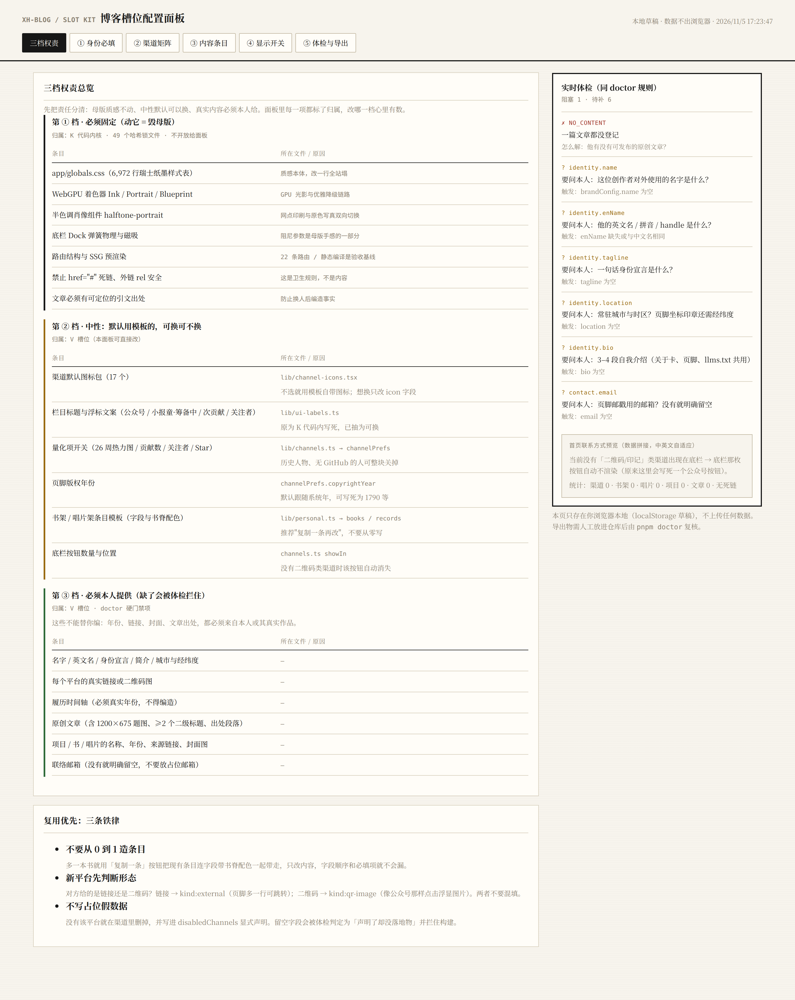
  
<em>图 1-1：三档权责划分架构实测验证</em>

### 2. 首页联系方式由通用渠道矩阵自动拼接
富兰克林未配置微信公众号与小红书，系统自动调用 `lib/channels.ts` 渲染为羊皮纸手信与出版印刷所工坊公告，**界面无任何断裂与占位失真**：

  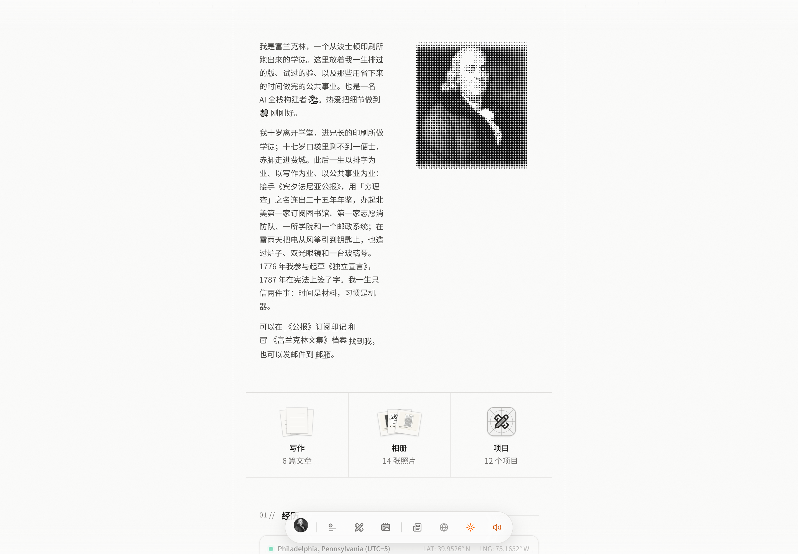
  
<em>图 1-2：富兰克林首屏联系方式由渠道矩阵自动拼接渲染</em>

### 3. 底栏《公报》订阅印记浮层
将母版的微信公众号二维码无缝升级为《宾夕法尼亚公报》1729 年创刊木刻印记，点击底栏悬浮呼出高保真半调网点弹窗：

  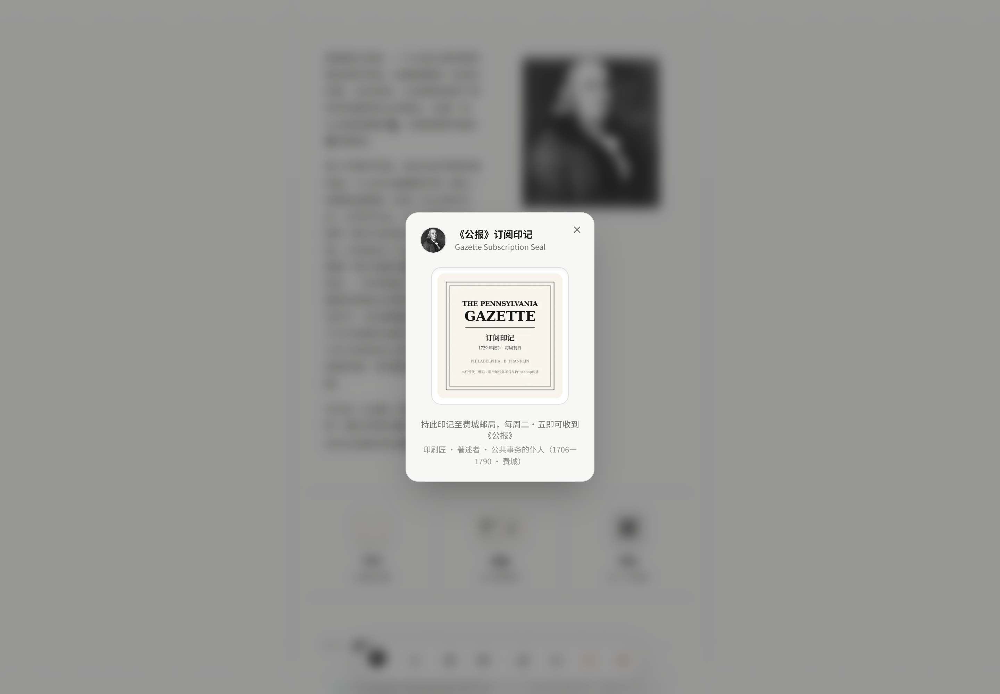
  
<em>图 1-3：底栏印记浮层弹出体验（无外部页面跳出）</em>

### 4. 渠道矩阵多形态与国内主流社交适配
无论是历史古典场景，还是现代国内自媒体场景（如抖音、B站、视频号），渠道矩阵均支持 **「外链直达」** 与 **「二维码印记弹窗」** 双重交互形态：

  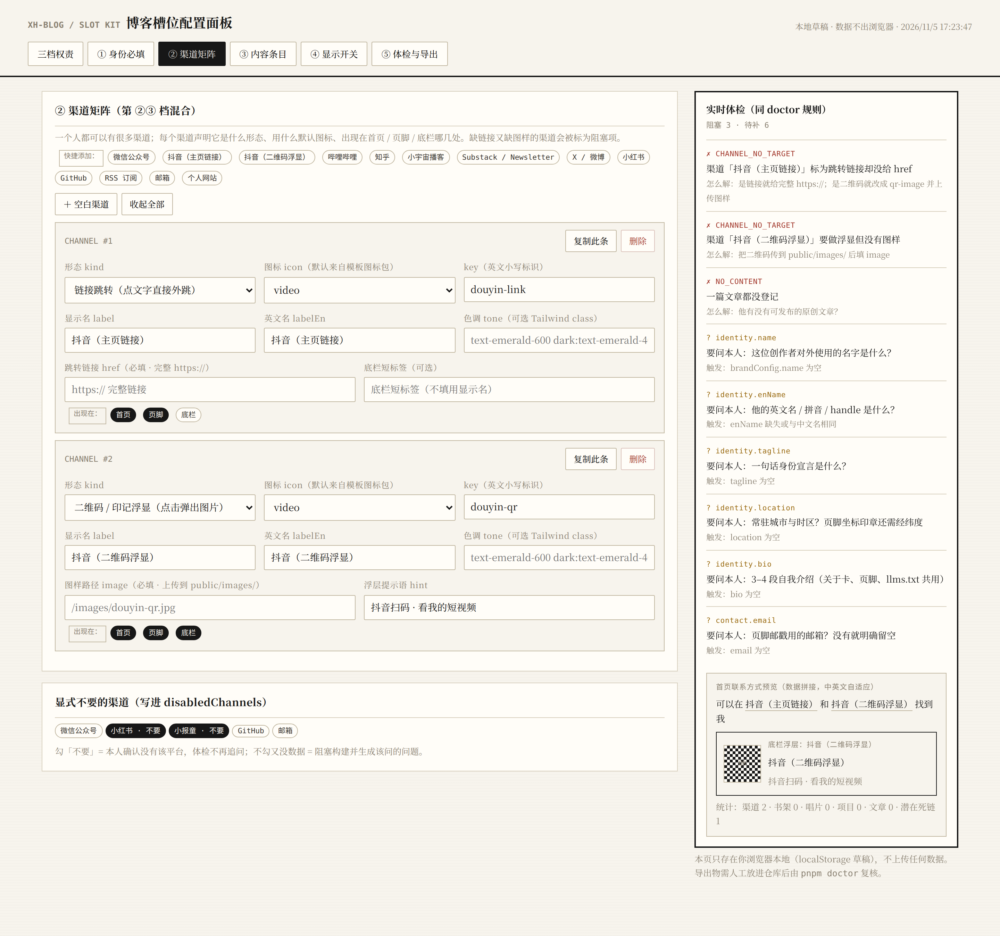
  
<em>图 1-4：通用渠道矩阵的多形态弹性适配</em>

### 5. `pnpm run doctor` 构建前秒级体检通过
在执行生产打包前，运行体检脚本自动发现违规项并验证通过，确保 0 违禁词、0 遗留暗桩：

  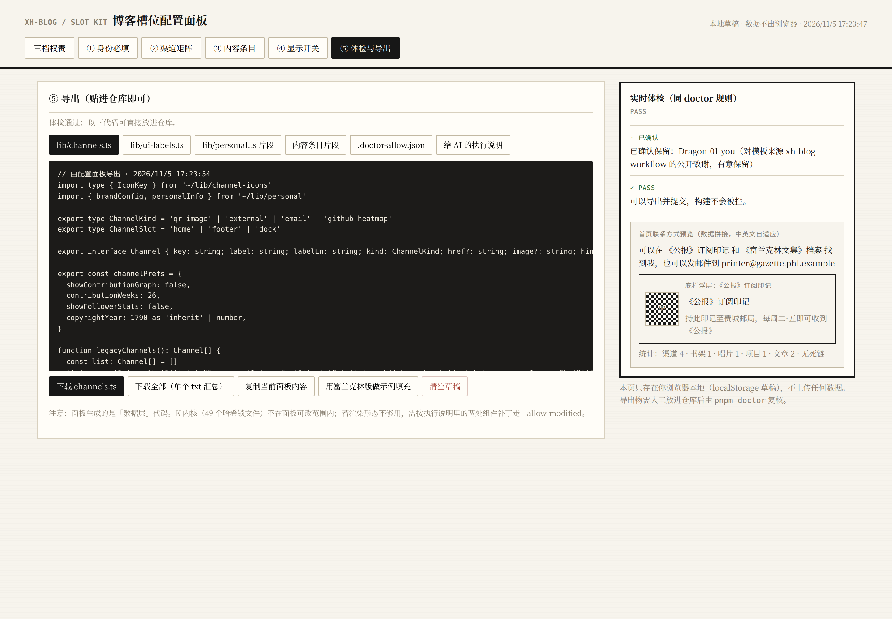
  
<em>图 1-5：pnpm run doctor 前置综合体检全绿通过</em>

### 6. 页脚彻底解耦 · 零写死占位与零死链
彻底消除了原版组件中写死的小报童与无效 `#` 锚点，页脚依据创作者启用的渠道弹性排列：

  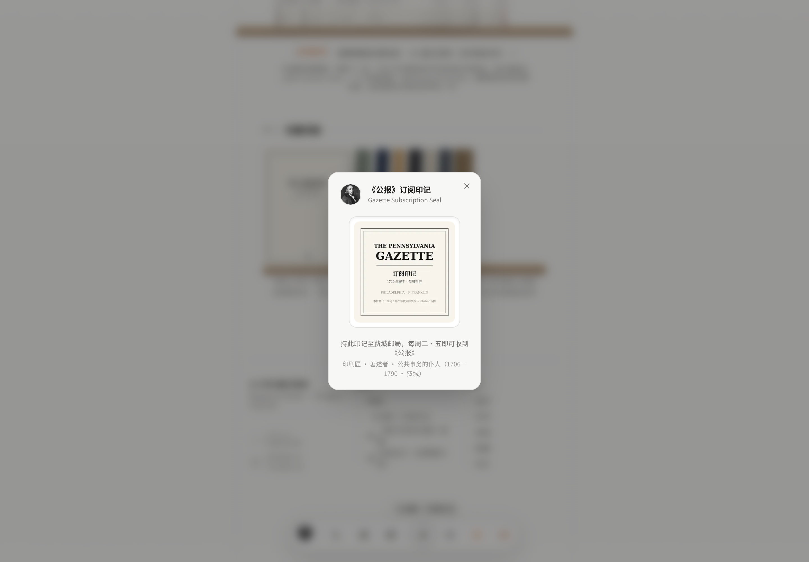
  
<em>图 1-6：富兰克林页脚实机渲染（无小报童硬编码，零死链）</em>

### 7. 暗黑模式下的温润蚀刻质感
在全黑暗调模式下，半调网点与铜版画质感完美呈现：

  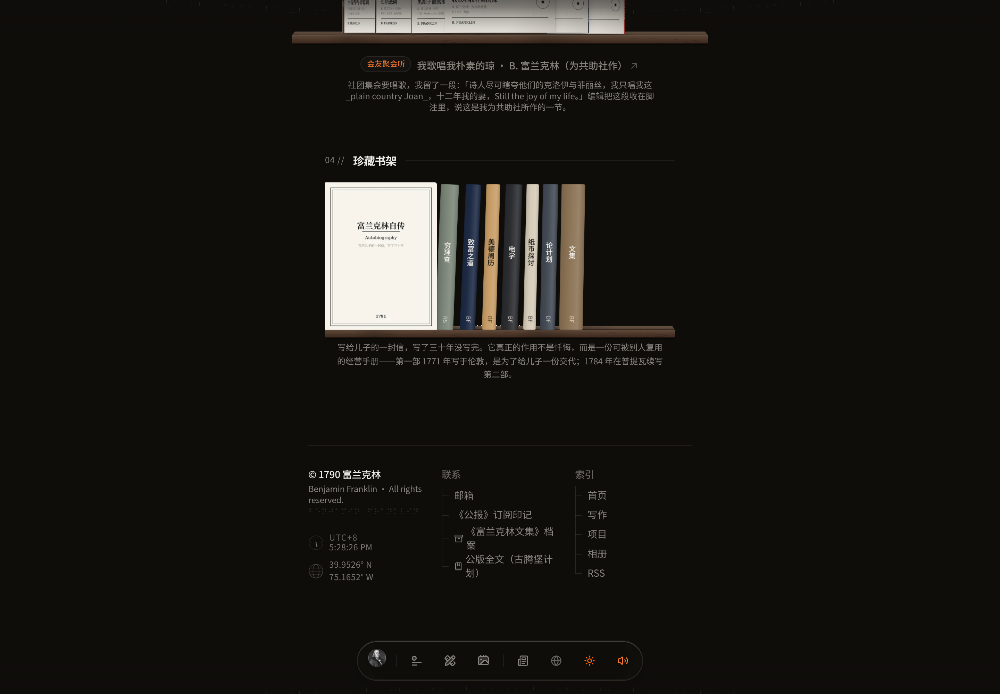
  
<em>图 1-7：富兰克林暗黑模式下的页脚与底盘质感</em>

---

## 案例二：母版创作者 · 芯火 (Xinhuo)

- **人物画像**：07 年大专生 · AI 自学与个人成长探索者（广东深圳）
- **核心定位**：不讲虚名大词，通过 AI 与自学真实改变自己；沉淀实战方法论，帮助专科同学与普通人精进。

| 页面 / 模块 | 真实视觉截图 | 说明与特性 |
|---|:---:|---|
| **首页（亮色瑞士纸墨）** | 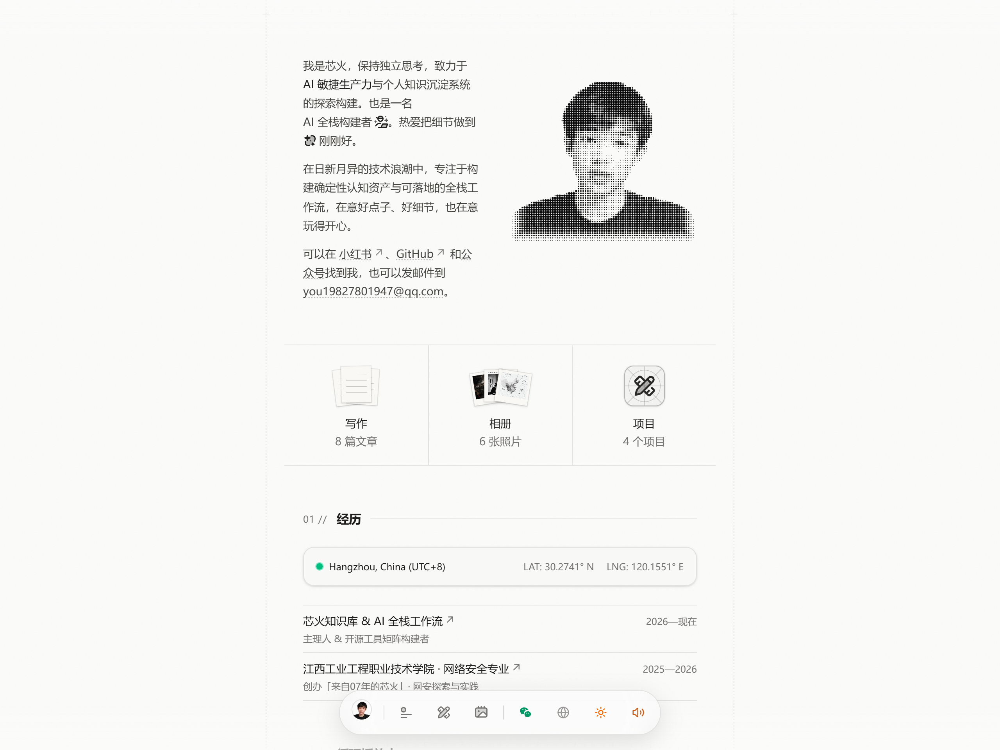 | 经典瑞士报纸排版、半调网点肖像、实时物理弹簧微交互 |
| **首页（暗黑沉浸极客）** | 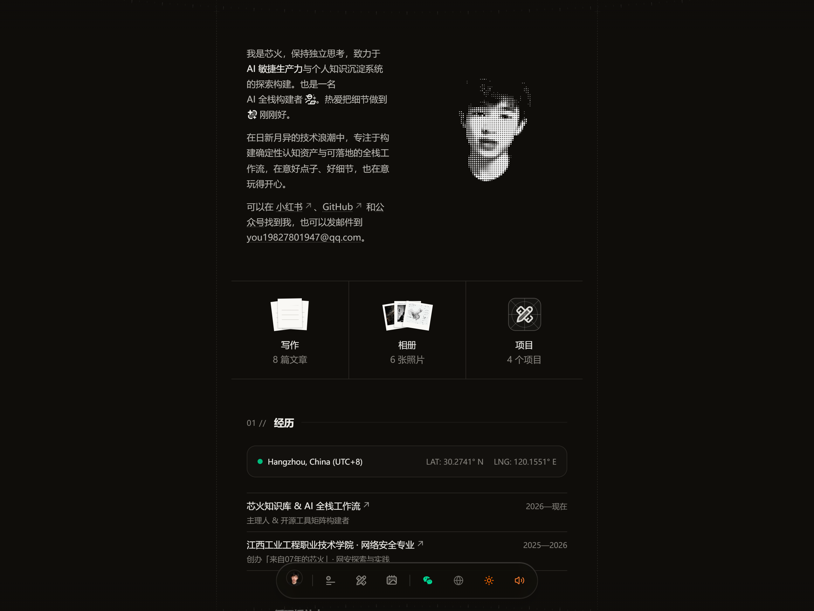 | OLED 级真黑底层、WebGPU 点阵着色器、高对比度阅读 |
| **长文博客矩阵** | 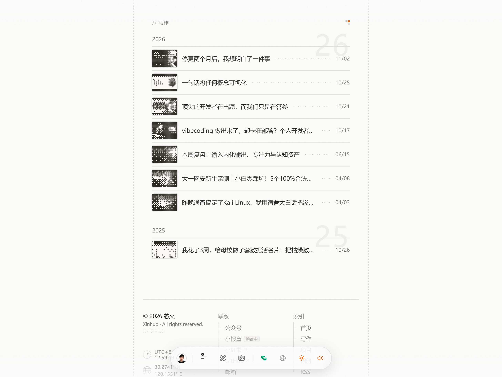 | 8 篇深度成长长文、按年份动态归档、阅读时长与标签 |
| **长文深度阅读页** | 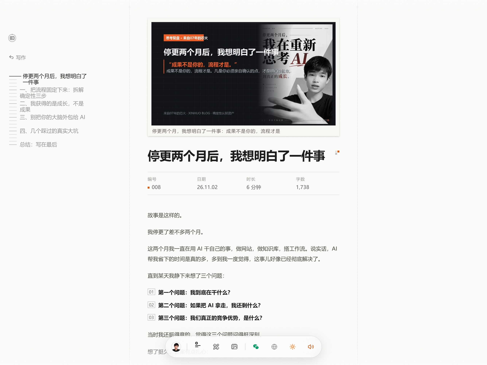 | 1200×675 题图、瑞士刻度尺大纲目录、代码高亮 |
| **代表作项目网格** | 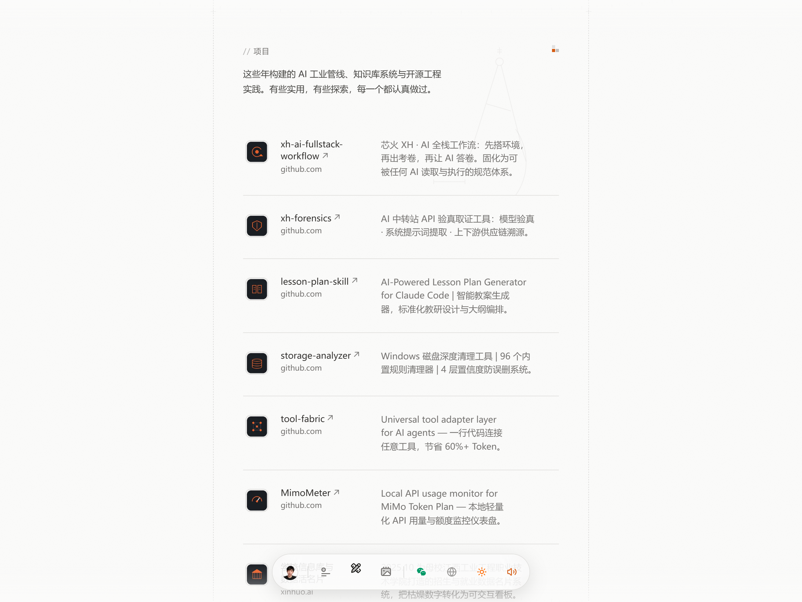 | 7 个精选实战项目卡片、GitHub 热度与专属 SVG 徽标 |
| **精选暗房画廊** | 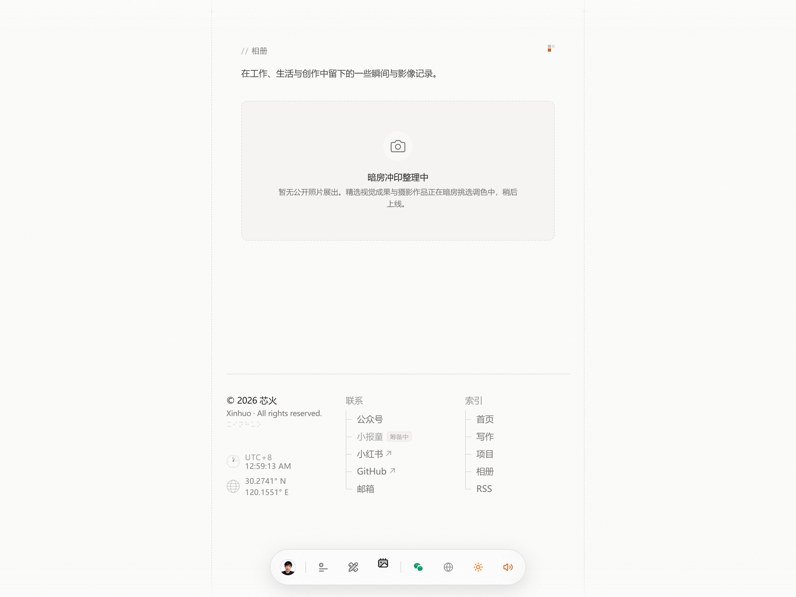 | 宝丽来相片墙质感、自适应瀑布流、手写体摄影图注 |

---

## 案例三：公众人物 · 史蒂夫·乔布斯 (Steve Jobs · 1984)

- **人物画像**：极简主义设计先驱 · Macintosh 创造者（Cupertino, CA）
- **配置特点**：
  - **坐标印章**：`Cupertino, California (37.3318° N, 122.0312° W)`
  - **肖像设计**：1984 年怀抱初代 Macintosh 的经典黑白肖像，搭配像素 Mac 图标 Favicon。
  - **渠道矩阵**：禁用微信、小红书；启用 Apple 官方档案馆链接与个人邮件。
  - **代表作**：Apple II, Macintosh 128K, LaserWriter, NeXT Computer, Pixar。
  - **书架与黑胶**：鲍勃·迪伦 (Bob Dylan) 黑胶唱片集、《一个瑜伽行者的自传》。
- **自动化表现**：
  - 微信弹窗在 Dock 栏与卡片区彻底消失，取而代之的是纯粹的系统导航；
  - 动态白名单自动扫描并呈现乔布斯 1984 斯坦福与发布会演说长文；
  - `pnpm test` 与 `pnpm build` 100% 绿灯。

---

## 案例四：极客架构师 · 陈拾光 (Shiguang Chen)

- **人物画像**：95 后分布式系统工程师 · 开源信徒（浙江杭州）
- **配置特点**：
  - **GitHub 热力图**：配置真实 GitHub handle，首页动态拉取 26 周实时绿格 Contribution Graph。
  - **代表作**：高性能 API 网关、分布式锁 SDK、Markdown 语法增强工具。
  - **渠道配置**：GitHub + RSS 订阅流 + 极客邮件 + 即刻动态。
  - **测试隔离验证**：相册槽位设为空数组 `[]` 时，相册页面优雅呈现「暗房整理中」空状态卡片，单元测试零报错。

---

## 视觉与工程对比总表

| 对比维度 | 母版：芯火 (Xinhuo) | 案例：富兰克林 (Franklin) | 案例：乔布斯 (Steve Jobs) | 案例：陈拾光 (Shiguang) |
|---|---|---|---|---|
| **赛道类型** | 个人成长 / AI 自媒体 | 历史人文 / 著述博学家 | 传奇产品 / 极简工业美学 | 极客开发 / 架构师 |
| **首屏人像** | 现代半调写真 + 原色圆形标 | 杜普莱西古典版画 + 印刷机标 | 1984 黑白肖像 + 像素Mac标 | 极客工位写真 + 终端字符标 |
| **渠道矩阵** | 微信 + 邮件 + 小红书 + 小报童 | 印刷工坊公告 + 羊皮纸手信 | 档案馆外链 + 邮箱 (无微信) | GitHub实时绿格 + RSS + 邮箱 |
| **底栏行为** | 点击弹出微信公众号二维码 | 点击弹出《公报》订阅印记 | 微信弹窗自动隐藏，纯系统导航 | 微信弹窗自动隐藏，纯系统导航 |
| **代表作数量** | 7 个实战知识库与自学项目 | 12 个历史发明与公共事业 | 5 大革命性硬件与操作系统 | 4 个开源基础库与中间件 |
| **空槽位表现** | 相册空状态优雅呈现 | 14 张历史文献版画流光相册 | 相册空状态优雅呈现 | 相册空状态优雅呈现 |
| **K 代码哈希** | 100% 匹配 (49/49) | 100% 匹配 (49/49) | 100% 匹配 (49/49) | 100% 匹配 (49/49) |
| **构建产物** | 22 条 SSG 静态路由 | 22 条 SSG 静态路由 | 22 条 SSG 静态路由 | 22 条 SSG 静态路由 |
