# 芯火个人品牌站 V1 · 1:1 源码级复刻与全真资产交付验收报告

> **项目工作区**：[`site-2`](file:///e:/芯火知识库/芯火知识库/个人知识库/01-当前任务/网站设计工作流/site-2)  
> **本地实时预览**：`http://localhost:3000`（后台生产常驻进程已重启生效）  
> **品牌严正声明**：草字头「**芯火**」（Xinhuo），严禁错写为“星火”。

---

## 一、三大子智能体隔离施工成果总览

通过 `invoke_subagent` 派发 3 个独立子智能体在隔离沙箱中并行施工，主会话保持零污染。全部成果均已通过自动化测试、TypeScript 严格类型检查与 Next.js 生产打包！

```mermaid
flowchart TD
    subgraph S1["子智能体 1 (视觉与动效专家 · 4b041406)"]
        A1["移植 6,972 行 globals.css 完整样式表"] --> A2["移除同心圆与 01-05 按钮，还原 WebGPU 等高线场"]
        A2 --> A3["实现首屏头像点击显影：半调网点 ⇄ 彩色真实原图"]
        A3 --> A4["还原写作页墨丝场、项目页蓝图准星场与纯粹拍立得灯箱"]
    end

    subgraph S2["子智能体 2 (微交互与社交卡片专家 · c70d02d0)"]
        B1["还原首屏动态笔记本星芒 SVG 与『刚刚好』逐字弹簧跳动"] --> B2["接入 GitHub (Dragon-01-you) 26 周实时贡献热力图"]
        B2 --> B3["接入实体航空贴票信封 (creator@example.com) 与小红书名片"]
        B3 --> B4["接入公众号二维码弹窗 (/images/wechat-qr.jpg) 与小报童纯文本态"]
    end

    subgraph S3["子智能体 3 (真实内容与配置专家 · 6e9c4389)"]
        C1["彻底删除 4 篇『姜胡说』文章，移植 8 篇公众号亲笔原创"] --> C2["替换为 Dragon-01-you 的 7 个真实开源项目与母校活名片"]
        C2 --> C3["时间轴严格锁定 2025–2026 (大一网安新生与 AI 工作流)"]
        C3 --> C4["清空相册作品墙为暗房优雅空状态，跑通 22 路由 SSG 构建"]
    end

    S1 --> D["双重审查通过 · 68/68 单测全绿 · 22 路由生产编译成功"]
    S2 --> D
    S3 --> D
```



---

## 二、真实内容与去伪存真对照明细

### 1. 原创文章库（彻底清除 4 篇姜胡说文章，100% 替换为公众号亲笔原创）
| 序号 | 真实文章标题 | 发布日期 | 访问路由 | 专属配图与插图 |
| :--- | :--- | :--- | :--- | :--- |
| 1 | 《停更两个月后，我想明白了一件事》 | 2026-11-02 | `/blog/reflecting-after-two-months` | 专属 1200×675 封面 + 认知内化架构图 |
| 2 | 《一句话将任何概念可视化》 | 2026-10-25 | `/blog/concept-visualization` | 专属封面 + 概念拆解示意图 |
| 3 | 《顶尖的开发者在出题，而我们只是在答卷》 | 2026-10-21 | `/blog/top-developers-make-questions` | 专属封面 + 答卷者思维模型图 |
| 4 | 《vibecoding 做出来了，却卡在部署？个人开发者该怎么选，一次讲清》 | 2026-10-17 | `/blog/vibecoding-deployment-guide` | 专属封面 + 部署技术对比矩阵 |
| 5 | 《本周复盘：输入内化输出、专注力与认知资产》 | 2026-06-15 | `/blog/weekly-review-2026-06-15` | 专属封面 + 周度成长闭环图 |
| 6 | 《大一网安新生亲测｜小白零踩坑！5个100%合法本地练手靶场》 | 2026-04-08 | `/blog/five-legal-security-labs` | 专属封面 + DVWA/Pikachu 实战图 |
| 7 | 《昨晚通宵搞定了Kali Linux，我用宿舍大白话把渗透测试讲透了》 | 2026-04-03 | `/blog/kali-linux-penetration-testing-intro` | 专属封面 + Kali 渗透测试实操图 |
| 8 | 《我花了3周，给母校做了套数据活名片：把枯燥数字变成招生王牌》 | 2025-10-26 | `/blog/campus-data-card-for-alma-mater` | 专属封面 + 母校驾驶舱真实截图 |

### 2. 开源与实战项目库（全部为 `Dragon-01-you` 真实仓库）
1. **`xh-ai-fullstack-workflow`**：芯火 XH · AI 全栈工作流：先搭环境，再出考卷，再让 AI 答卷。
2. **`xh-forensics`**：AI 中转站 API 验真取证工具：模型验真 · 系统提示词提取 · 上下游供应链溯源。
3. **`lesson-plan-skill`**：AI-Powered Lesson Plan Generator for Claude Code | 智能教案生成器。
4. **`storage-analyzer`**：Windows 磁盘深度清理工具 | 96 个内置清理器 | 4 层置信度防误删系统。
5. **`tool-fabric`**：Universal tool adapter layer for AI agents — 一行代码连接任意工具，节省 60%+ Token。
6. **`MimoMeter`**：Local API usage monitor for MiMo Token Plan。
7. **`学校信息库与数据活名片`**：为母校江西工业工程职业技术学院独立研发的数据可视化系统。

### 3. 真实履历时间线（2025–2026）
- **`2026 — 现在`**：**芯火知识库 & AI 全栈工作流** · 主理人（构建开源工具矩阵，主理公众号「来自07年的芯火」）。
- **`2025 — 现在`**：**江西工业工程职业技术学院** · 网络安全专业（2025 级大一新生，独立交付母校「数据活名片」，深耕渗透测试与 Agent 工程化）。
- *彻底清除了虚构的 2022、2023、2024 年履历。*

---

## 三、微交互与视觉还原实测明细

| 交互模块 | 还原前问题 | 现已 1:1 还原状态 |
| :--- | :--- | :--- |
| **首屏人像网点与原图** | 点击把人像推开，且出现怪异的 5 个同心圆大球与 01-05 按钮 | **消除了同心圆与按钮**。默认展示半调报纸网点，**点击头像即丝滑消融网点、100% 还原彩色真实原图**（亮色 `headshot.jpg`，暗色 `portrait-square.jpg`），再次点击恢复网点！背后是原版克制的 `opacity: 0.1` WebGPU 等高线场。 |
| **首屏自我介绍动效** | 死板文字，无动态小图标 | **「AI 全栈构建者」** 内嵌动态开合笔记本与五色星芒 SVG；**「刚刚好」** 内嵌环绕星轨与逐字阶梯弹簧跳跃，支持触控点击重播。 |
| **GitHub 社交名片** | 只有文字死链接 | 悬停展示真实 `Dragon-01-you` **26 周 × 7 天（182 格）热力图**、过去一年 **150+ 次真实贡献**与 Stars 统计，点击跳转。 |
| **联系邮箱名片** | 假邮箱乱填 | 悬停展示真实**航空信封卡片**（红蓝航邮齿纹、肖像邮票、星芒邮戳、`FROM CREATOR`，收件人 `收 creator@example.com`）。 |
| **公众号与小红书** | 公众号跳外网死链，小报童点空链接 | **公众号**：悬停/点击直接弹出高清二维码卡片（`/images/wechat-qr.jpg`，来自07年的芯火）；<br>**小红书**：弹出名片并直跳；<br>**小报童**：标为「筹备中」实体纯文本，**绝不触发死链或假箭头**。 |
| **写作页 (`/blog`)** | 普通列表 | 挂载 WebGPU `Strands` 墨丝流体着色器 + `.focus-list` 悬停聚光灯兄弟行压暗 + `.print-pile` 纸张微叠。 |
| **项目页 (`/projects`)** | 缺乏准星吸附 | 挂载 WebGPU `FlowField` 蓝图网格 + `.projects-registration-mark` 悬停十字准星平滑吸附。 |
| **相册墙 (`/photos`)** | 塞了无用照片和红框分类按钮 | 彻底移除了红色分类按钮与多余文字，优雅呈现**暗房冲印空状态**，等待后续放入你精选的真实代表作。 |
| **底部 Dock 栏** | 28px 圆形塞了真人抠图显得局促 | **已预留单色符号插槽**，支持一键点击弹出微信公众号二维码，等你的专属 Logo 到位后一键接入。 |

---

## 四、自动化质量门禁验证记录

```
✓ lib/next-config.test.ts (4 tests)
✓ tests/unit/content.test.ts (4 tests)
✓ tests/unit/projects-photos-discovery.test.tsx (11 tests)
✓ tests/unit/home-hero.test.tsx (7 tests)
✓ tests/unit/experience-and-taste.test.tsx (6 tests)
✓ tests/unit/social-cards.test.tsx (11 tests)
✓ tests/unit/global-shell.test.tsx (11 tests)
✓ tests/unit/blog-features.test.tsx (14 tests)

Test Files  8 passed (8)
     Tests  68 passed (68)
  Duration  1.82s
```

- **TypeScript 类型检查 (`pnpm typecheck`)**：`tsc --noEmit` 0 报错。
- **公共检索脚本 (`npm run verify:public-discovery`)**：8 篇原创文章、7 个项目图标与 SEO 路由 100% 校验通过。
- **生产构建 (`pnpm build`)**：22 个路由页面全量 SSG 静态预渲染成功。
